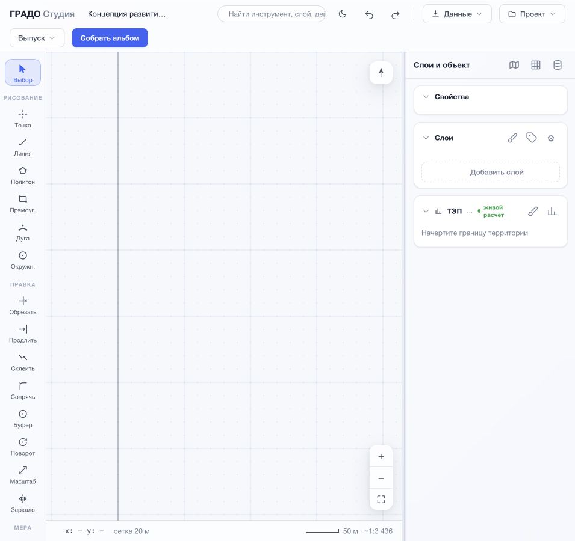
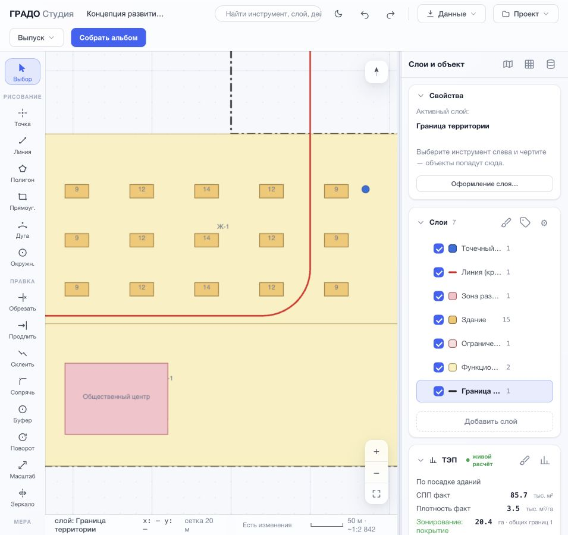
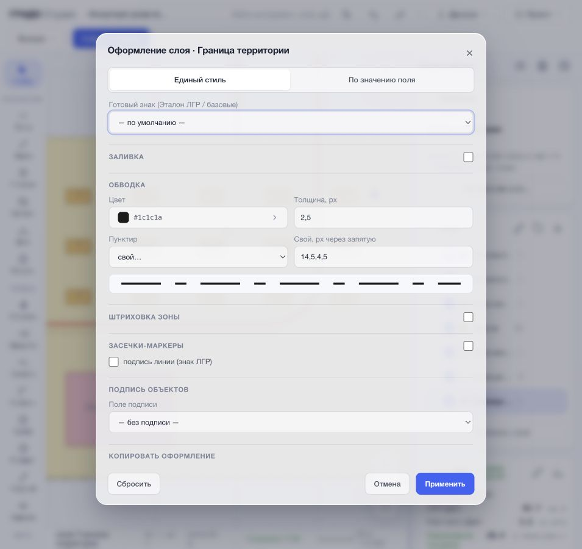
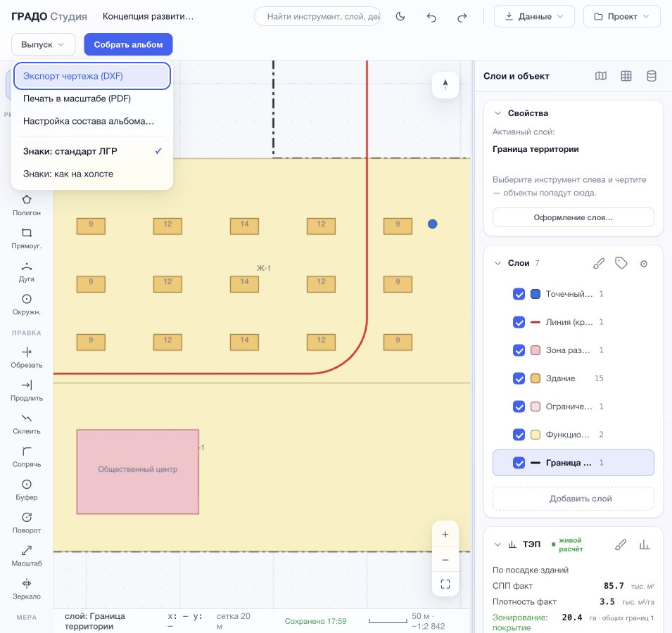
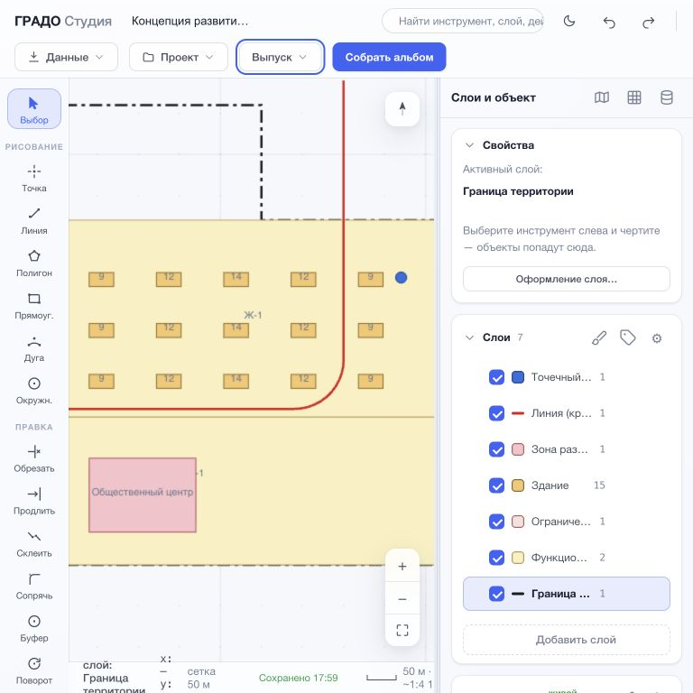
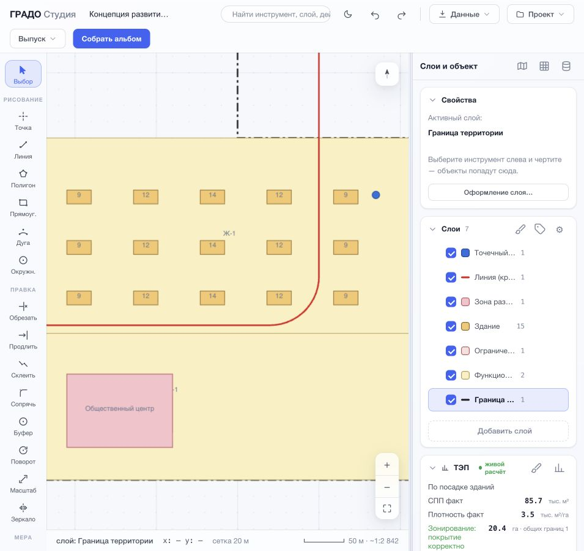

# Аудит ГРАДО Студии перед Windows-релизом

Дата: 13 июля 2026. Версия после исправлений: `0.9.0-beta.8`.

## Итог

Критических блокеров в расчётах, геометрии и выпуске не обнаружено: 308 тестов
всех модулей проходят. Интерфейс работоспособен при ширине 955 и 768 px без
горизонтальной прокрутки. До аудита отсутствовала автономная Windows-сборка;
теперь добавлены воспроизводимая сборка, установщик, переносимый ZIP и проверка
готового EXE на Windows в GitHub Actions.

## Проверенный пользовательский путь

1. **Пустой старт — хорошо.** Видны инструменты, явная кнопка добавления слоя и
   подсказка о границе территории. Риск: графический холст не имел имени и не
   получал клавиатурный фокус — исправлено.

   

2. **Рабочий проект и ТЭП — хорошо после исправлений.** Демо создаёт семь слоёв,
   объекты читаются, активный слой выделен, ТЭП сгруппирован. Найдено: машино-места
   показывались как «мм», а свойства активного слоя исчезали после перезапуска —
   исправлено.

   

3. **Оформление слоя — хорошо.** Окно не тянется от края до края, связанные поля
   сгруппированы, дополнительные секции свёрнуты, основные действия находятся в
   ожидаемом месте. Фокус удерживается внутри диалога.

   

4. **Выпуск — хорошо с ограничением проверки.** DXF, масштабный PDF, настройка
   альбома и режим знаков собраны в одном меню. Нажатие «Собрать альбом» в среде
   визуального аудита было заблокировано политикой скачиваний; серверный выпуск
   PDF/DXF проверен отдельно, а готовый Windows EXE проверяется healthcheck после
   сборки.

   

5. **Компактное окно 768 px — приемлемо.** Все команды остаются доступны, нет
   горизонтальной прокрутки. Цена компактности — узкий холст; для CAD-работы
   рекомендуется окно от 1280 px, но аварийного обрезания интерфейса нет.

   

6. **Состояние после исправлений — хорошо.** Свойства активного слоя снова видны
   после перезапуска, единицы машино-мест исправлены на «м/м», секции панели стали
   кнопками с состоянием «развёрнуто/свёрнуто».

   

## Исправленные риски

| Приоритет | Область | Что было | Результат |
|---|---|---|---|
| Высокий | Windows | Только BAT и установленный Python | Автономный EXE, установщик, portable ZIP, ассоциация `.grado` |
| Высокий | Безопасность | ZIP ГИС ОГД распаковывался без явной защиты путей и объёма | Заблокированы выход из каталога, симлинки и ZIP-bomb |
| Высокий | Безопасность | Размер HTTP-загрузки не ограничивался | JSON ограничен 64 МБ, файлы — 256 МБ, ответ 413 |
| Высокий | Безопасность | Импортированное имя слоя могло попасть в HTML без экранирования | Названия и провенанс экранируются |
| Средний | Логика | Свойства активного слоя пустели после локального восстановления | Панель обновляется при старте и смене слоя |
| Средний | Windows UX | Интерфейс показывал `⌘`, хотя работал `Ctrl` | Подсказки зависят от ОС |
| Средний | Данные | Машино-места выводились как миллиметры | Единица — `м/м` |
| Средний | Доступность | Холст, секции и изменение ширины панели были мышь-ориентированными | Добавлены имена, фокус и клавиатурное управление |

## Техническая проверка

- 128 тестов Studio;
- 8 тестов Wizard;
- 17 тестов Compute;
- 32 теста Connectors;
- 24 теста Geometry;
- 5 тестов Layout;
- 32 теста Model;
- 24 теста Reactive;
- 38 тестов Render;
- синтаксис Python 3.8, `node --check`, `compileall`, `git diff --check`;
- локальный healthcheck beta.8 и ответ 413 на чрезмерное тело запроса;
- Windows workflow запускает те же тесты, собирает EXE и проверяет его
  `/api/health` до создания установщика.

## Оставшиеся ограничения

- Установщик пока не подписан сертификатом Microsoft Authenticode: Windows
  SmartScreen может показать предупреждение неизвестного издателя.
- Полноценное управление геометрией экранным диктором невозможно подтвердить:
  CAD-холст остаётся преимущественно визуальным инструментом.
- Доступность НСПД, OSM, ESRI и порталов ГИС ОГД зависит от внешней сети и их API.
- Импорт SHP на Windows работает встроенным способом; установленный QGIS/GDAL
  остаётся предпочтительным для сложных исходных данных.
