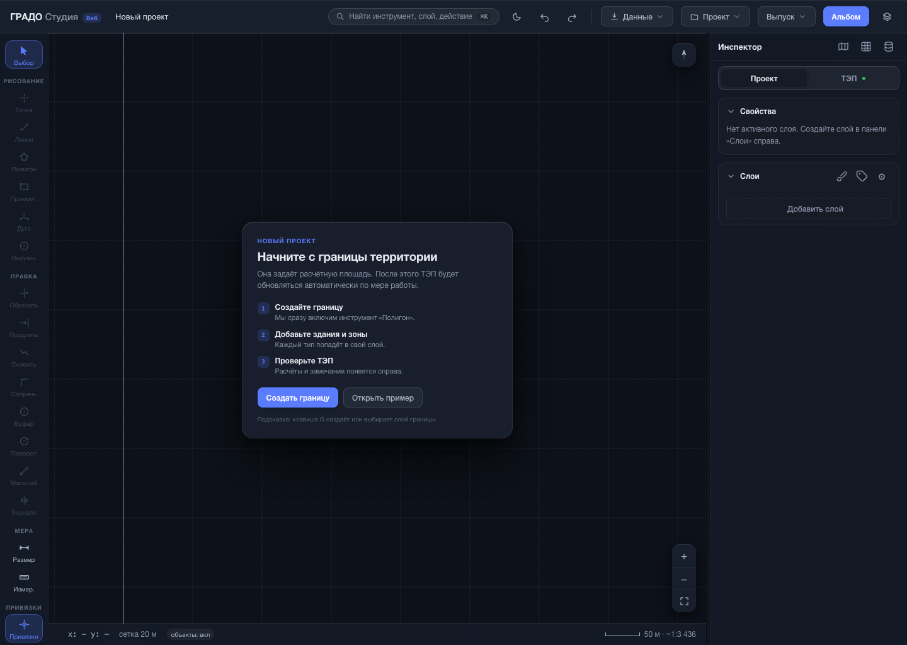
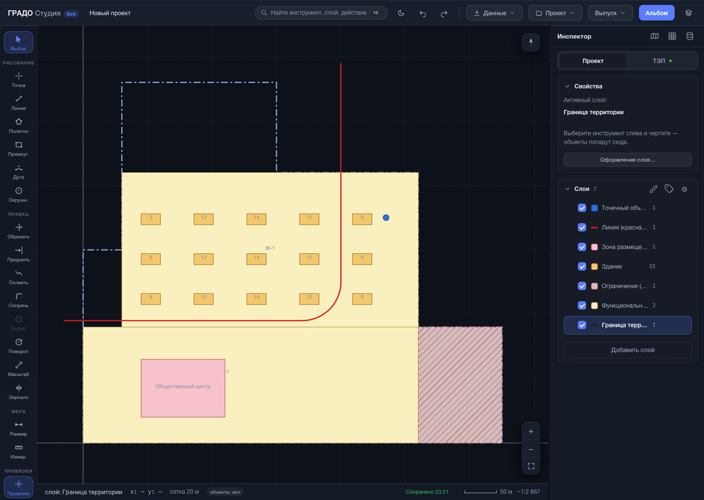
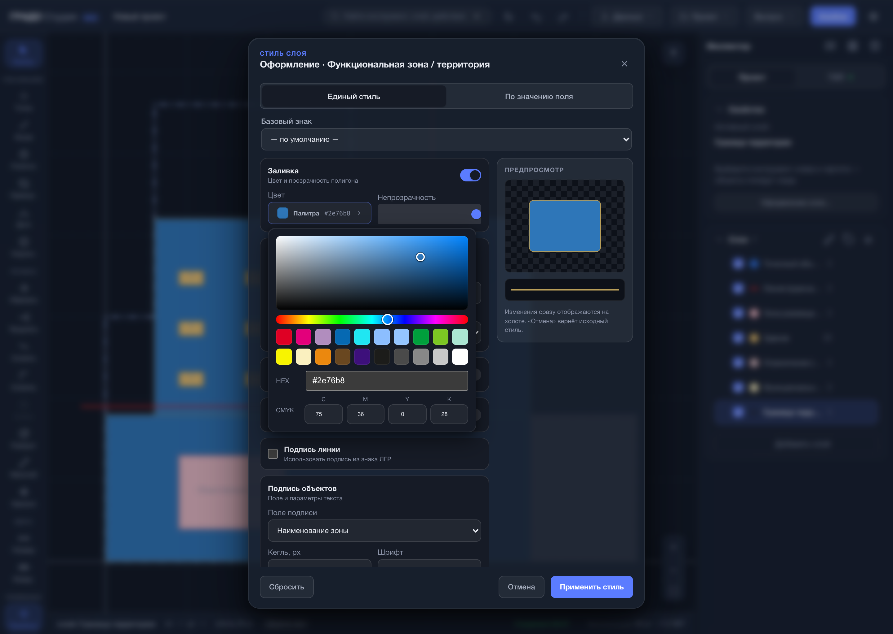
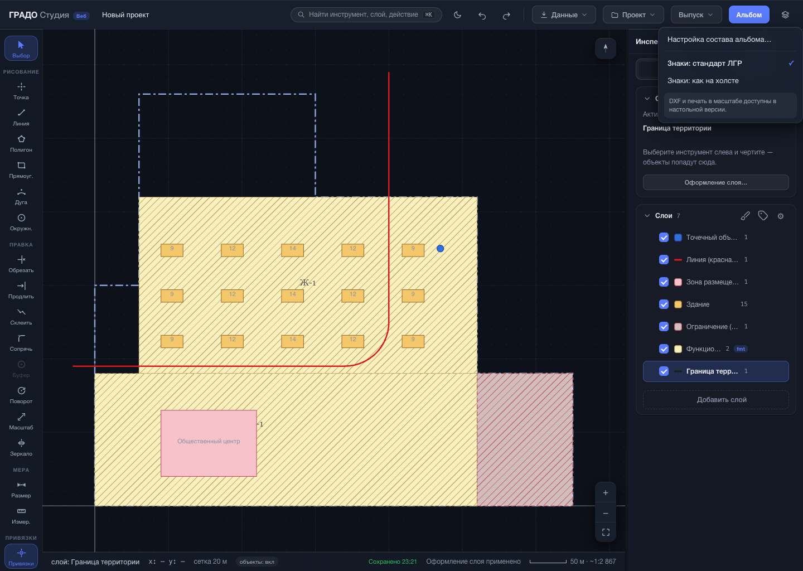
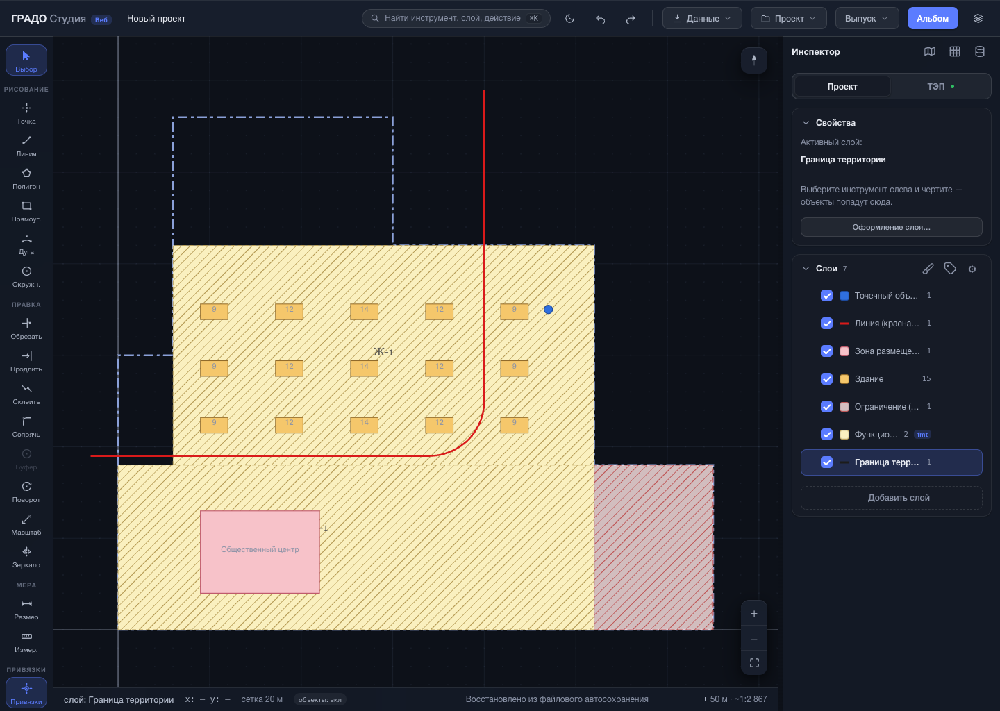

# Аудит браузерной (GitHub Pages) редакции ГРАДО Студии

Дата: 14 июля 2026. Версия после исправлений: `0.9.0-beta.43`.

## Итог

Браузерная редакция собрана из исходников (`packaging/build_pages.py`) и проверена
как чистая статика без Python-бэкенда (локальный `http.server`, headless-Chrome по
DevTools Protocol — без сторонних установок). Критических блокеров не обнаружено:
черчение, слои, оформление, ТЭП, автосохранение в IndexedDB и честная блокировка
настольных функций работают. Найден и исправлен один реальный дефект UX выбора
цвета (по жалобе пользователя). 350 тестов всех модулей проходят, из них node-фикстуры
браузерного ядра (ТЭП-паритет с настольной версией, импорт НСПД/GeoJSON/экстента, CRS,
привязки, автосейв) — зелёные.

## Проверенный пользовательский путь

1. **Пустой старт — хорошо.** Загружается как статика, бейдж «Веб» у логотипа
   подтверждает режим Pages. Онбординг объясняет путь «граница → зоны → ТЭП», видны
   «Создать границу» и «Открыть пример», в «Свойствах» честно «Нет активного слоя».

   

2. **Демо-проект и ТЭП — хорошо.** «Открыть пример» создаёт семь слоёв; объекты
   читаются, активный слой выделен. ТЭП считается целиком в браузере (площадь 24.48 га,
   расчётное население 9065, потребность ДОО/школ по 2151-ПП, предупреждения-проверки) —
   тот же `computeTep`, что покрыт node-паритетом с настольным движком.

   

3. **Выбор цвета — исправлено.** Было (жалоба пользователя): «нет палитры, окно сразу
   закрывается». Стало: (а) в строку HEX добавлена нативная палитра-спектр (полный выбор
   цвета/пипетка ОС) наряду с кураторскими образцами ЛГР и CMYK для печати; (б) клик по
   образцу больше не закрывает окно — виден живой предпросмотр, можно сравнить и подстроить
   (закрытие по клику вне поля); (в) прокрутка высокого диалога больше не роняет открытый
   выбор. На снимке — образец нажат, окно открыто, предпросмотр обновился.

   

4. **Оформление слоя — хорошо.** Проверены все контролы «Единого стиля»: заливка/
   непрозрачность, обводка (цвет/толщина/тип), штриховка (угол/шаг), маркеры линии,
   подпись (поле/кегль/шрифт/цвет). Каждый доходит до модели (`layer.fmt`) и до холста;
   на снимке применена штриховка + подписи. «Базовый знак» подставляет эталон ЛГР
   (напр. ООПТ — красный контур, штриховка, без заливки), режим «По значению поля»
   добавляет правила категоризации.

   

5. **Выпуск — честная блокировка.** DXF и печать в масштабе скрыты и заменены явной
   пометкой «доступны в настольной версии»; доступны настройка состава альбома и режим
   знаков. Ничего не падает молча. Инструмент «Буфер» отключён с подсказкой.

   

6. **Перезагрузка — хорошо.** Правки пишутся в IndexedDB (origin браузера); после
   перезагрузки страницы проект полностью восстанавливается (застройка, слои, ТЭП),
   без Python-сервера.

   

## Найденные и исправленные проблемы

| Приоритет | Область | Что было | Результат |
|---|---|---|---|
| Средний | UX выбора цвета | Нет непрерывной палитры — только 20 образцов и числовые поля | Добавлен нативный спектр ОС в строку HEX (`app-style-ui.js`, `.cf-native`) |
| Средний | UX выбора цвета | Клик по образцу мгновенно закрывал окно — нельзя посмотреть/подстроить | Клик по образцу больше не закрывает; закрытие по клику вне поля |
| Низкий | UX выбора цвета | Прокрутка высокого диалога закрывала открытый выбор цвета | Прокрутка репозиционирует поповер у кнопки |

Исправление закоммичено как `v0.9.0-beta.43` (коммит `e2ada94`).

## Техническая проверка

- 350 тестов всех модулей (Studio 229 — включая 56 упаковки, Render 38, Connectors 32,
  Model 32, Compute 19) — зелёные;
- node-фикстуры браузерного ядра (в `test_packaging`): паритет ТЭП с настольным движком
  на числовых краях и релизной фикстуре, импорт НСПД/ГИС ОГД GeoJSON, сборка/импорт по
  экстенту OSM/НСПД, точность CRS против PROJ, привязки, приём GeoJSON и отказ ZIP,
  автосейв в IndexedDB с откатом на localStorage — зелёные;
- `node --check` для `pages-core.js`, `pages-adapter.js`, `app-style-ui.js`;
- живой прогон собранной Pages-редакции (headless-Chrome по CDP): все шаги 1–6 выше;
- консоль браузера чистая на всём прогоне (ошибок нет).

## Метод визуальной проверки

Скриншоты сняты в собранной Pages-редакции (`build_pages.py` → локальный `http.server`)
через системный Chrome в headless-режиме по DevTools Protocol (встроенные `fetch`/
`WebSocket` Node 24, без установки Playwright/Puppeteer и без загрузки браузеров).
Подложка OSM/спутник в этих кадрах не отрисована — headless-окружение без доступа к
тайл-серверам; в обычном браузере с сетью подложка грузится (проверено отдельно в
интерактивном прогоне).

## Оставшиеся ограничения (по устройству редакции, не дефекты)

- Серверный импорт (НСПД/ГИС ОГД по пути/URL, ZIP-выгрузки), буферы, PDF/DXF и
  сборка альбома в масштабе — только настольная версия; в браузере честно помечены.
- В браузере доступны OSM и НСПД по видимой области и файлы НСПД/GeoJSON; ZIP и прямые
  ссылки требуют настольную версию.
- `srcKey`-дедупликация повторной выгрузки не переживает round-trip файла проекта
  (общее ограничение обеих редакций).
- Доступность OSM Overpass, НСПД и тайл-серверов зависит от внешней сети и их API.
