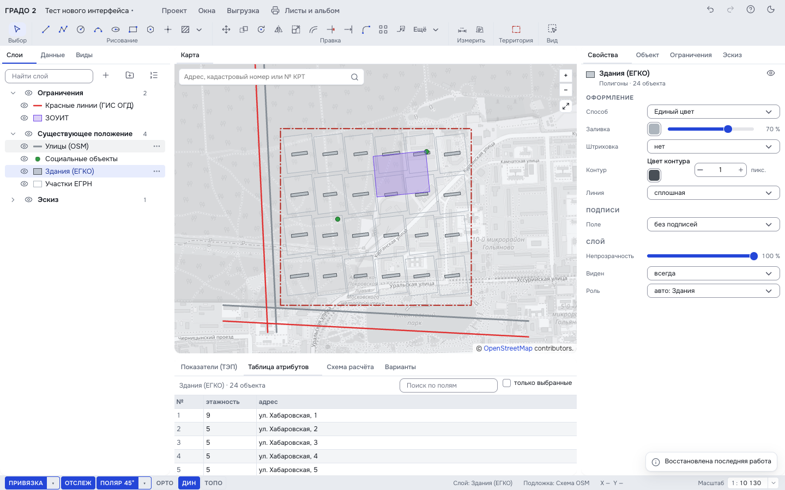
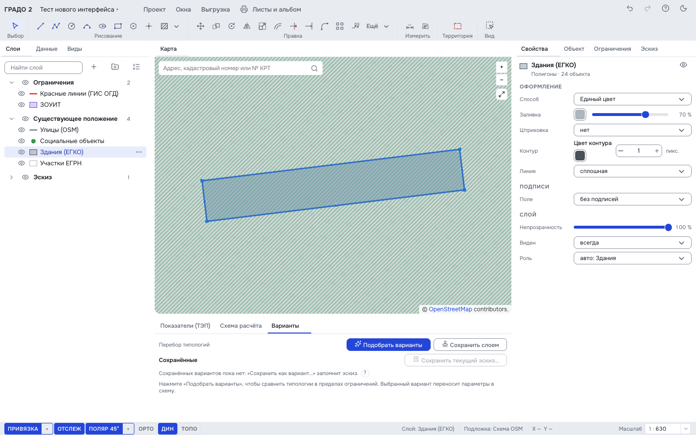
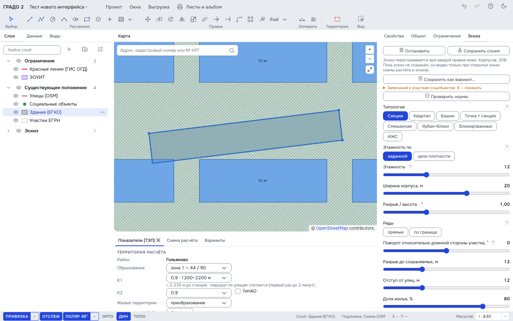
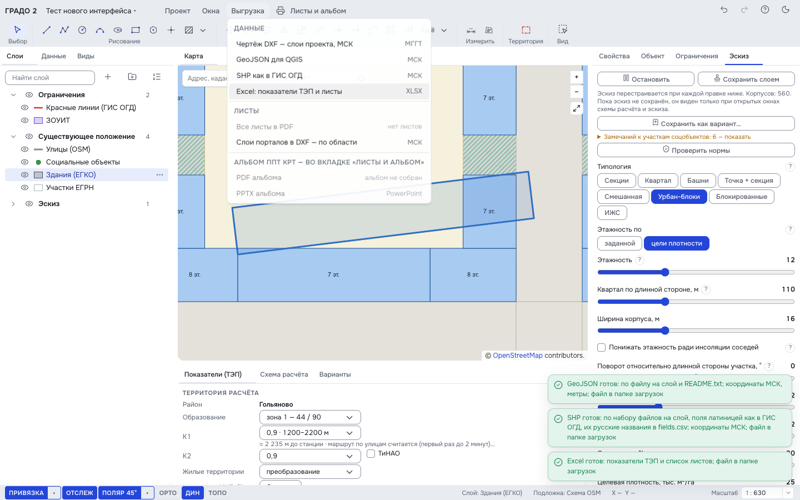
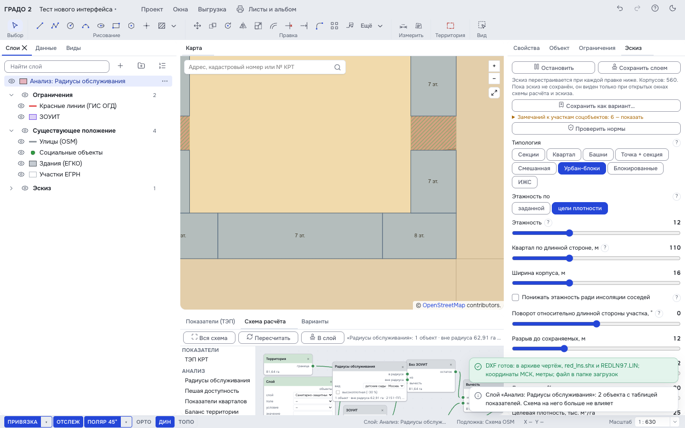
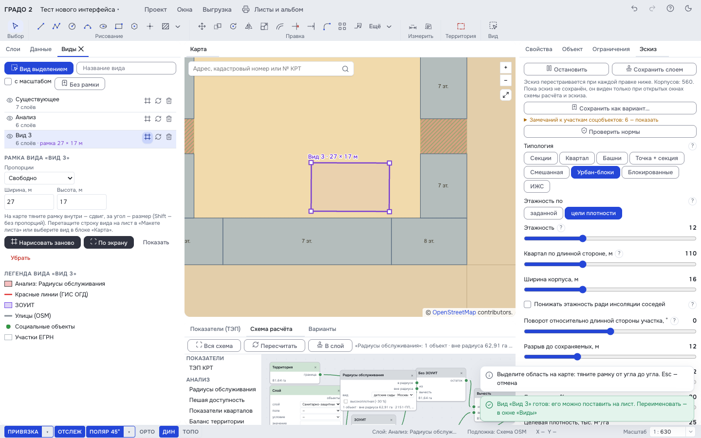

# Первый район за 30 минут

Учебный маршрут по ГРАДО 2: от пустого проекта до эскиза района с показателями — на встроенной
границе-примере (Ходынское поле, 46,09 га). Каждый шаг — «что на экране → что нажать → что должно получиться».
Времени — около получаса; больше всего уходит на первую выгрузку данных с порталов. Запуск программы —
[install.md](install.md), интернет нужен: данные приходят с порталов (ГИС ОГД, ЕГРН, OSM, Яндекс).

Правки автосохраняются сами, поэтому прерваться можно на любом шаге и вернуться позже. Если что-то пошло не так —
консоль браузера (F12) и [install.md](install.md), раздел «Если что-то не запускается».

## Шаг 1. Новый проект (≈ 2 минуты)

**Что на экране →** после запуска браузер сам открывает `http://localhost:8650` — это уже новый интерфейс.
Сверху строка с «ГРАДО 2», меню «Проект», «Окна», «Выгрузка» и кнопкой «Листы и альбом»; в центре — карта Москвы;
слева окно «Слои», справа «Свойства», внизу «Показатели (ТЭП)» и «Таблица атрибутов». Название проекта в шапке —
«Без названия» (или открыт последний проект из папки проектов).

**Что нажать →** меню «Проект» → «Новый проект».

**Что должно получиться.** Внизу справа появится карточка-сообщение: «Новый проект. Прежний остался в папке
проектов, если был сохранён». Слои, граница и данные — пустые.

## Шаг 2. Поставить границу-пример (≈ 1 минута)

**Что на экране →** слева рядом со «Слоями» есть вкладка «Данные» (если вкладки не видно — меню «Окна» →
«Данные»). В окне три шага сверху вниз: 1 «Граница территории», 2 «Загрузка данных», 3 «В проекте».

**Что нажать →** кнопку «Пример» в первом шаге. На пустом проекте пример ставится сразу. Если у проекта уже
есть граница или данные, молча пример не поставится: кнопка превратится в вопрос «Граница-пример на Ходынском
поле — поставить?» (или «Заменить вашу границу примером?»), и подтвердить надо вторым щелчком в течение 5 секунд.

**Что должно получиться.** Карта сама подлетает к Ходынскому полю, граница — красный штрихпунктирный контур.
Внизу справа — карточка «Граница-пример: 46,09 га», у первого шага вместо цифры «1» — зелёная галочка.

## Шаг 3. Загрузить данные по границе (≈ 10 минут)

**Что на экране →** вокруг границы на карте — синяя рамка области загрузки (видна, пока открыто окно «Данные»).
Без границы кнопка загрузки была бы серой с подсказкой «Сначала задайте границу территории» — теперь она работает.

**Что нажать →** «Выбрать источники и загрузить…». В окне «Исходные данные» сверху — готовые наборы. Отметить
«Существующее положение» (здания, вода, зелень, дороги, участки — основа любой схемы) и «Ограничения» (ЗОУИТ,
СЗЗ, водоохранные зоны, красные линии, аэродромы, ОКН). В папке «ЕГРН · НСПД» отметить «Здания (ЕГРН)», в папке
«OpenStreetMap» — «Здания (OSM)»: это сохраняемые здания для эскиза. Слой быстрее найти поиском по имени.
Нажать «Загрузить в проект».

**Что должно получиться.** В окне «Данные» — карточка хода выгрузки: полоса и строка на каждый слой (идёт,
готово, пусто, «портал не ответил»), шапка «Выгрузка: готово N из M». Слои появляются на карте и в «Слоях» по
мере прихода — работать можно, не дожидаясь конца. В конце шапка станет «Загружено N слоёв»; у слоёв, которые не
ответили, — кнопка «Повторить: N слоёв». Первая выгрузка больших слоёв ГИС ОГД идёт по всей Москве и занимает несколько
минут, дальше они берутся с диска; большие области НСПД и OSM скачиваются по частям. Если «Здания (ЕГРН)» не
загрузились (НСПД требует сертификаты Минцифры — см. [install.md](install.md)), эскиз возьмёт «Здания (OSM)».

## Шаг 4. Посмотреть, что вокруг (≈ 3 минуты)

**Что на экране →** карта наполнилась: здания, дороги, зелень, подписи. В окне «Слои» — слои группами; в «Данных»
третий шаг «В проекте» показывает, сколько объектов в каждом источнике и когда выгружено; под ним — сводка
«Существующее положение в границе».

**Что нажать →** в «Слоях» щёлкнуть строку «Здания (ЕГРН)» (или «Здания (OSM)») — слой станет текущим; затем
щёлкнуть здание на карте. Если окна мешают, Ctrl+\ прячет их («Только карта»), повтор или Esc возвращает.
Подложка меняется внизу строки состояния: «Подложка: …».

**Что должно получиться.** Справа в окне «Объект» — название слоя, площадь в МСК и атрибуты здания, объект
подсвечен синим. Выбор работает в текущем слое: если объект не выбирается, внизу справа появится карточка
с подсказкой, из какого он слоя.

## Шаг 5. Рассчитать ограничения (≈ 4 минуты)

**Что на экране →** окна «Ограничения» в раскладке нет — оно открывается по мере надобности.

**Что нажать →** меню «Окна» → «Ограничения», затем «Рассчитать ограничения». Галочки «Что учитывать» и
параметры уже отмечены по умолчанию; у галочек и полей есть подсказки при наведении.

**Что должно получиться.** В «Слоях» появилась группа «Ограничения» — запреты и предельная высота по солнцу;
в окне — журнал, из каких слоёв что взято. В схему расчёта сам добавляется блок «Ограничения»: пятно застройки
минус запреты, корпуса не выше предельной высоты. Выключенный слой группы «Ограничения» эскиз учитывать перестанет.

## Шаг 6. Построить эскиз района (≈ 4 минуты)

**Что на экране →** меню «Окна» → «Эскиз»: окно встанет вкладкой рядом с правыми окнами. Пока оно открыто, на
карте виден предварительный просмотр — пятно застройки (свободная часть границы) и сохраняемые здания.

**Что нажать →** «Построить эскиз». Типология «Секции» и этажность 12 уже выбраны; ползунки ниже (ширина
корпуса, этажность, разрывы) перестраивают эскиз сразу на карте.

**Что должно получиться.** На пятне застройки — корпуса. Пока окно «Эскиз» открыто, эскиз виден на карте;
кнопка «Сохранить слоем» превращает корпуса, участки и улицы в обычные слои группы «Эскиз: …» — их можно
править, оформлять и выгружать.

## Шаг 7. Показатели (≈ 3 минуты)

**Что на экране →** внизу — окно «Показатели (ТЭП)» (технико-экономические показатели). Район подставился сам —
зона образования, K1 и K2 берутся по району, на который приходится большая часть границы; под K1 появится
расстояние пешком до метро. Строки «Цель по ПЗЗ» может не быть: она считается по загруженным подзонам ПЗЗ
(готовый набор «Градостроительная документация» в окне выбора источников).

**Что нажать →** ничего — таблица считается сама после эскиза. Если рядом с «Целью по ПЗЗ» появилась кнопка
«взять цель», она ставит целью плотности эскиза предельную плотность ПЗЗ.

**Что должно получиться.** Таблица «Эскиз»: «Новые корпуса», «СПП новая» (суммарная поэтажная площадь),
«Плотность итоговая» против «Цели», «Застроенность», «Сохраняется», «Под снос»; ниже — группы показателей
«Калькулятора 2.0»: население, социальные объекты, машино-места. Первый расчёт K1 ищет пешеходный маршрут по
улицам до метро — до 2 минут. Excel с показателями — меню «Выгрузка» → «Excel: показатели ТЭП и листы».

## Шаг 8. Сохранить проект (≈ 1 минута)

**Что на экране →** правки автосохраняются через 1,5 секунды после последней; точка «•» у названия в шапке
означает, что есть правки, не записанные под именем проекта.

**Что нажать →** «Проект» → «Сохранить» (или Ctrl+S) и ввести название, например «Мой первый район».

**Что должно получиться.** Внизу справа появится карточка «Проект „Мой первый район“ сохранён»; файл .grado2 лежит в папке
проектов «Документы/ГРАДО 2». При следующем запуске он откроется сам.

## Что дальше

- Граница-пример — учебная. Свою территорию ставят в окне «Данные» («Нарисовать», «Из файла», «По участкам») или
  поиском над картой: ввести адрес или кадастровый номер, найти участок, «Сделать границей территории» —
  при замене существующей границы поиск тоже переспросит.
- F1 — «Справка»: все окна, команды и клавиши с поиском по словам.
- «Проверить нормы» в окне «Эскиз» — инсоляция новых домов и окон соседей, слой «Проверка норм» с причиной у каждой точки.
- «Сохранить как вариант…» в окне «Эскиз» — запомнить эскиз и сравнить типологии в окне «Варианты».
- Окно «Схема расчёта» показывает, как всё связано: граница, слои, ограничения, пятно, эскиз, ТЭП. Правка схемы —
  правка того, что и из чего считается.
  
- Кнопка «Листы и альбом» (Ctrl+P) — альбом ППТ КРТ: листы, штамп, PDF и PPTX.
  
- Прежняя рабочая страница со всеми окнами — `/old`: тот же проект открывается и там, и там.
- Один проект — одно окно. Автосохранение общее на все окна и вкладки: вторая вкладка с тем же проектом молча
  перезапишет его автосохранение — «кто последний, тот и прав». Для работы над одним проектом одновременно —
  общий сервер ([collab.md](collab.md)).
