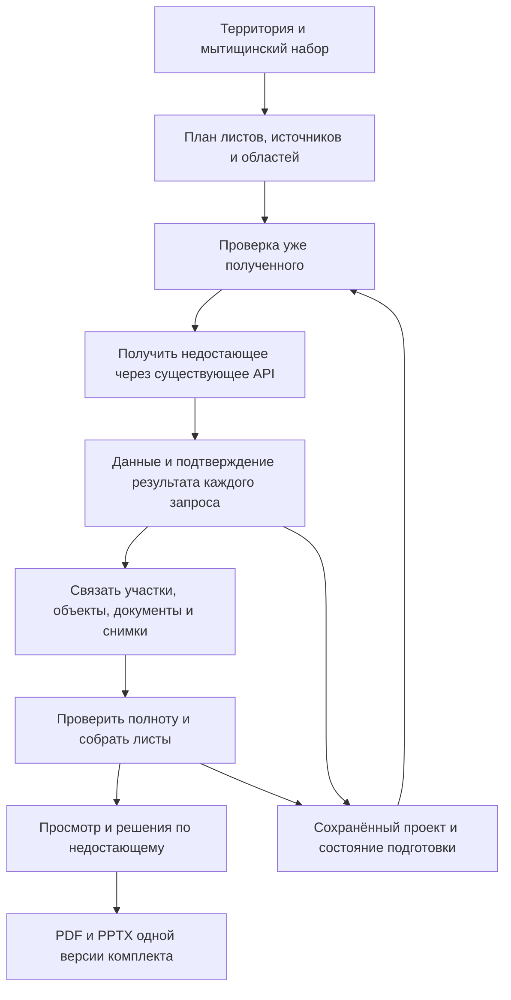

# Полная презентация существующего положения по мытищинскому образцу

Автор: Codex по требованиям владельца ГРАДО. Дата: 29.10.2026.
Задача: [#167](https://github.com/tayeela/grado-studio/issues/167).
Статус: редакция 2; замечания полного ревью разобраны по указанию владельца «Делай».
Ограниченный повтор проверки завершён; найденные замечания исправлены. Прежние вердикты
сохранены без изменения, нового полного пятистадийного PASS не заявляется.
Реализация не начата. Последнее указание владельца заменяет браузерный захват прямым скачиванием.
Основание: задача #167 и согласованные в этой сессии требования владельца.
Материалы: [паспорт образца](167-sushpol/reference-passport.md),
[данные исходной копии](167-sushpol/source-evidence.md),
[проверка скачивания](167-sushpol/panorama-download-check.md).
Обязательные части редакции 2: [контракты реализации](167-sushpol/implementation-contract.md),
[матрица листов](167-sushpol/sheet-contracts.md), [вёрстка](167-sushpol/layout-contract.md)
и [канонический паспорт](167-sushpol/layout-v1.json).
Эти приложения уточняют краткие описания ниже и имеют приоритет для типов/API/проверок готовности;
при расхождении реализация останавливается до устранения противоречия, а не выбирает удобный текст.
[Исходное ревью](167-sushpol/review/consolidated_review_report.md) относится к первой редакции;
[разбор исправлений](167-sushpol/review/goldfish_review_report.md) — ко второй.

EGM artifact directory: /Users/tayeela/grado-saas-readiness/work/egm/grado/saas-readiness

## Обзор

ГРАДО 2 должен проводить владельца через весь путь подготовки презентации существующего положения:
задание территории, получение данных внутри программы, сборка тематических листов, проверка полноты
и комплектование PDF и редактируемого PPTX по мытищинскому образцу.

Владелец не должен заранее скачивать слои с порталов, вручную переносить карты в PowerPoint и заново
комплектовать презентацию после каждого обновления. Основной путь использует встроенные инструменты
ГИС ОГД, НСПД, OSM и Яндекс Карт. Программа определяет необходимые материалы по выбранному образцу,
территории и охвату листов. Произвольная ручная загрузка файлов остаётся дополнительной возможностью.

## Проблема

В ГРАДО уже есть получение данных, сборка альбомов и экспорт, но текущие наборы отличаются от мытищинского
образца составом и порядком. Отдельные земельно-имущественные и социальные листы не представлены в том же виде.
Пока нельзя подтвердить, что владелец получает полный результат без ручного комплектования вне программы.

Повторное открытие, изменение исходных данных и сбои порталов не должны скрывать неполноту или терять
ручную работу. Наличие страниц и успешная выгрузка сами по себе не подтверждают содержание и готовность.
Кодовые основания и пределы проведённой проверки перечислены в принятой концепции и журнале проверок.

## Цели

1. Получать исходные слои внутри ГРАДО по территории и потребностям презентации. Основной путь работает
   без ручного составления перечня зависимостей каждого листа в каталоге источников.
2. Собрать все виды материалов образца: карты, подписи, легенды, таблицы и их взаимосвязи. Содержание
   определяется данными выбранной территории; адреса, площади и объекты образца не становятся константами.
3. Показывать ход работы и различать успешное получение, подтверждённое отсутствие объектов, неполное
   покрытие, сбой и устаревший результат. Для недостатка показывать затронутый лист и выполнимое действие.
4. Сохранить проект, вновь открыть его и продолжить незавершённую подготовку с видимыми причинами неполноты.
   Работа без открытой вкладки не является условием этого раздела: продолжение идёт с записанных этапов по контракту реализации.
5. Обновлять материалы с сохранением предусмотренных ручных правок. Состав сохраняемых полей и разрешение
   конфликтов заданы техническим планом и приложениями; молчаливая потеря правок недопустима.
6. Получать единый PDF и редактируемый PPTX с согласованными составом, порядком, подписями и данными.
   Готовность подтверждается проверкой итоговых файлов и полного пользовательского пути.

## Состав результата

Мытищинский файл содержит 14 физических слайдов. Для нового набора обязательны все представленные в нём
виды материалов. Число страниц с таблицами, карточками и фотографиями уточняется по объёму данных:
увеличение числа участков не должно приводить к пропуску строк или нечитаемому уменьшению текста.
Правила разбиения и нумерации входят в дальнейшие разделы ТЗ.

| Позиция образца | Материал | Что должно быть связано в результате |
|---|---|---|
| 1 | Титул | Название проекта, территория, округ/район, дата |
| 2 | Положение в городе и округе | Территория, административные границы, названия и выноска |
| 3 | Ортофотоплан района | Обзорный снимок, район, транспорт, станции, топонимы, положение территории |
| 4 | Ортофотоплан территории | Более крупный снимок, граница и читаемое окружение |
| 5 | Существующее использование с показателями | Землепользование, участки, застройка, условные знаки, показатели |
| 6 | Земельно-правовая таблица | Номера участков, кадастровые номера, площади, права и реквизиты исходных документов |
| 7 | Схема участков и ОКС | Те же участки и номера, их характеристики и подтверждённая связь с объектами капитального строительства |
| 8 | Ограничения | Отдельный тематический состав зон и линий, условные знаки, перечни объектов |
| 9 | Фотофиксация | Снимок, его номер, точка и направление на карте |
| 10 | Генплан | Функциональные зоны, их индексы, параметры, легенда и таблица |
| 11 | ПЗЗ | Две согласованные схемы: территориальные зоны/ВРИ и подзоны/параметры |
| 12 | Документация с ГПЗУ | Границы документов, номера, названия, реквизиты и пояснения |
| 13 | Образование | Подтверждённые объекты, подписи и доступность по указанной методике |
| 14 | Здравоохранение | Подтверждённые объекты, подписи и зоны с обозначением «Транспортно-пешеходная доступность» |

Позиции таблицы обозначают физический порядок исходника. Повтор видимого номера 7 и несовпадение
номеров с порядком в исходнике не переносятся автоматически. Два листа сущпола имеют разные задачи:
использование с показателями и ограничения. Объединять их из-за похожего названия нельзя.

Новый набор должен иметь отдельную идентичность. Существующие альбомы ППТ КРТ и прежний раздел сущпола
сохраняют свои правила и смысл листов. Открытие старого проекта не заменяет его новым набором автоматически.

## Условия готовности

Для каждого листа программа должна объяснять, из каких данных он собран и что осталось не проверено.
Присутствие геометрии участка не подтверждает право, договор, период действия или принадлежность ОКС.
Отсутствие ответа портала не означает отсутствие объектов на территории.

Черновую выгрузку можно получить с сохраняемым перечнем проблем. Полный комплект считается готовым,
когда все обязательные проверки выполнены, данные связаны с источниками, нерешённых обязательных
пропусков нет, а допустимые исключения явно приняты владельцем и сохранены с результатом.
Набор обязательных полей и допустимых исключений определяется по каждому виду листа в техническом плане.
Чужая готовая презентация, догадки и автоматически поставленные прочерки не заменяют недостающие сведения.

Программа использует действующую схему координат проекта: всё показываемое, вводимое и экспортируемое —
МСК, как в QGIS; линейные размеры — в метрах, площади имеют явно указанные единицы. Исходные системы
порталов и преобразования следуют существующим правилам ГРАДО. Масштаб карты и бумажная рамка должны
соответствовать действительным размерам; численные контрольные примеры заданы в техническом плане.

## Основные пользовательские сценарии

### От территории до комплекта

Исходное состояние: пользователь открыл ГРАДО, задал территорию; готовых слоёв и альбома для неё нет.
Действие: начинает подготовку презентации по мытищинскому образцу.
Результат: программа определяет источники и охват, получает доступные данные встроенными средствами,
собирает все виды листов, показывает причины неполноты и позволяет получить PDF/PPTX.
Статус готовности соответствует условиям выше и проверяется по содержанию итоговых файлов.

### Сбой источника и продолжение

Исходное состояние: часть данных получена, один источник не ответил либо дал частичный результат.
Действие: пользователь сохраняет и закрывает проект, затем открывает его и продолжает подготовку.
Результат: полученные материалы и ручные правки сохранены; проблемные листы и причины остаются видимыми;
продолжение не объявляет прежнюю неполную сборку готовой и не требует заново комплектовать весь альбом.

### Обновление с ручными правками

Исходное состояние: пользователь уже поправил рамки, названия, подписи или фото; у источника появились новые данные.
Действие: обновляет исходные данные и связанные материалы.
Результат: обновлены затронутые материалы, предусмотренные ручные изменения сохранены, а неразрешимый
конфликт показан до перезаписи. Прежний результат можно восстановить по правилам технического плана.

## Границы первого выпуска

Этот этап доводит законченный рабочий сценарий владельца. Он не требует публичной регистрации,
продажи подписок, обязательной LLM, новой многопользовательской архитектуры или полной замены редакторов.
Эти направления не отменяются, но не служат условием приёмки данного результата.

Недоступные сведения и измерения не выдумываются. Подход к дополнительным документам и снимкам,
методика доступности, ограничения размера проекта и длительности операций определяются до реализации.
Не обещается получение из подключённых источников сведений, доступность которых ещё не проверена.

## Где закреплены правила

- Источники, поля, формулы, допустимые исключения и правила образования — матрица листов.
- Подтверждения охвата, состояния/API, ревизии, снимки local/hub, совместимость и пределы — контракты реализации.
- Размеры, роли, шрифты, переносы и неделимое переполнение — паспорт и правила вёрстки.
- Скачивание панорам, ручной азимут, отмена, дедлайн и общая пауза источника — контракт фотофиксации.

Полный браузерный путь пока не проверен: локальный браузер отключён в настройках Work.
Прямое скачивание метаданных и JPEG-тайлов отдельно проверено; это не заменяет приёмку приложения.

## Технический план

### Принятое направление

Развить существующее получение данных и сборщик альбома. Создать отдельный набор
«Существующее положение — мытищинский образец», сохранить выбранные Vue, dockview, Web Awesome,
OpenLayers, Konva и существующие экспортные ядра. Полная замена редактора и постоянное серверное
задание не входят в принятый первый этап.

Новый набор использует действующие листы альбома и их печать, а не импортирует готовые картинки
мытищинских карт. Образец задаёт композицию, реальные карты строятся по данным выбранной территории.
Ручное редактирование листа остаётся доступным. Встроенный движок применяется через существующий мост;
дополнительная независимо изменяемая копия проекта не создаётся.

### Путь данных

Для владельца основной вход — выбрать этот набор и начать подготовку. Программа показывает состав,
источники и области до начала получения данных. Ручной каталог источников остаётся расширенным
инструментом. Не требуется сначала самому подобрать все слои, а затем отдельно искать подходящий альбом.

### Ответственность существующих частей

| Часть | Что остаётся её задачей | Изменение для нового сценария |
|---|---|---|
| Новый интерфейс: DataPanel.vue и AlbumPanel.vue | Территория, отображение данных и листов, действия владельца | Вход в подготовку, план, состояния листов, продолжение и конкретные действия по проблемам |
| albumhost.js и albumapi.js | Обмен с действующим движком | Подтверждение версии перед началом, передача команд подготовки и возврат подтверждённых результатов |
| sheetlayout.js и sheets.js | Планирование потребностей листов, источники и сборка | Использовать существующий план; добавить подтверждённое покрытие, контрольные точки и обновление по зависимостям |
| albums.js и отдельное описание нового набора | Тематическое содержание и оформление листов | Отдельные правила мытищинского набора, новые таблицы и тематические листы |
| server.py и коннекторы | Получение, нормализация, ограничения запросов, печать и запись проекта | Структурированное подтверждение полученных областей/частей, причин неполноты и идентичности операции |
| portalgate.py | Координация обращений к порталам | Повторно использовать; отдельную очередь не создавать |
| print_io.py, album_io.py и существующие экспортные ядра | Отрисовка и итоговые файлы | Дополнить нужными композициями и таблицами; общий источник содержания PDF/PPTX |

Названия новых модулей и перечень изменений зафиксированы в разделе реализации и контракте.
Здесь определяется граница ответственности, а не предлагается новая платформа.

### Идентичность набора и листов

Набор получает собственный идентификатор и версию правил. Каждый тематический лист получает постоянный
смысловой ключ, независимый от положения в списке: например, использование, ограничения, земельно-правовая
таблица. Порядок показа хранится отдельно. Изменение порядка не изменяет смысл листа или привязанных правок.

Если таблица занимает несколько страниц, дополнительные страницы связаны с исходным тематическим листом;
строки и карточки связываются с устойчивыми ключами участков и объектов. Номер на плане и номер страницы
не используются в качестве идентификатора исходного объекта.

Существующие индексы и префиксы SEC1/ППТ КРТ не переопределяются. Старый проект открывается с прежними
листами. Переход на новый набор выполняется отдельным действием с сохранением исходного результата.

### План получения и подтверждение покрытия

Потребность листа описывает тематическую роль, допустимые источники, область и обязательные сведения.
При совпадении источника и области листы используют одну загрузку. План учитывает уже полученное,
его происхождение, область и пригодность; наличие объектов слоя само по себе не доказывает покрытие.

Сетевые запросы продолжают использовать POST /api/fetch. К существующему ответу layers/errors добавляется
необязательная структурированная часть о выполнении: идентификатор запроса, запрошенная область,
фактически проверенные части, время, статус, использованный источник и код причины неполноты.
Старые клиенты продолжают получать прежние поля; старый сервер без подтверждения покрытия считается
источником неподтверждённого результата, а не автоматически полного.

Подтверждение строится в том месте, где известен реальный результат обращения или чтения кэша.
Его нельзя восстановить по габариту найденных объектов: в успешно проверенной области объектов может не быть.
При разбиении каждая часть имеет отдельный исход; при пропуске подслоя его полнота также остаётся непроверенной.
Сокращённая сервером область и кэшированный результат указываются явно вместе с исходной датой данных.

Геометрические области успешных запросов объединяются без заполнения промежутков. Доля покрытия считается
по пересечению с нужной областью в МСК. Покрытие геометрии и наличие обязательных атрибутов — отдельные проверки.
Порог выбора запасного источника в старом сборщике не является порогом готовности нового комплекта.
Неизвестное покрытие и недопустимые пробелы оставляют лист неполным.

Контрольный пример: требуется полоса 1000 × 100 м. Получены левый и правый участки по 400 × 100 м,
между ними пропуск 200 × 100 м. Общий габарит совпадает с требуемым, но покрытие равно
(40 000 + 40 000) / 100 000 = 80 %. Лист остаётся неполным. Перекрытие частей не суммируется дважды.

Ограничения площади, разбиение, паузы и кэш берутся из действующих адаптеров. При недопустимом охвате
программа предлагает допустимое получение частей или изменение рамки, не сжимает её молча.
Повторы учитываются суммарно с серверными; клиент не запускает второй цикл автоматически после того,
как сервер исчерпал допустимые попытки. Для решения используется код причины, а не поиск слова в тексте.

### Состояние подготовки в проекте

Для нового набора сохраняется компактное состояние подготовки внутри метаданных альбома:
идентификатор и версия набора, идентификатор запуска, зависимости, результаты запросов, состояния листов,
решения владельца и сведения о последней проверенной выгрузке. Геометрия и снимки остаются в существующих
данных проекта и листах; журнал не содержит вторую полную копию каждого слоя.

Такое размещение использует существующее сохранение album.meta и обмен разделом album.
Отдельное неизвестное поле верхнего уровня сейчас недостаточно: split/join и применение проекта движком
не гарантируют его сохранение. Для состояния подготовки задаются явные очистка при новом проекте,
копирование, открытие и согласование; один лишь Object.assign не должен переносить запуск из прежнего проекта.

Состояние запроса: запланирован → выполняется → получен / успешно пуст / частичный результат / ошибка.
После открытия прежнее «выполняется» превращается в «прервано, нужно продолжить», пока результат не подтверждён.
Состояние листа отдельно: ожидает → собирается → требует данных или решения / требует проверки / готов / устарел.
«Запрос завершился» не означает «лист готов».

Полученные данные и их подтверждения сохраняются одним состоянием проекта после завершённых групп работ.
Контрольная точка считается записанной только после успешного ответа существующего механизма сохранения.
При ошибке записи работа помечается несохранённой; программа не обещает продолжение с этой точки.
Неподтверждённые или незаписанные этапы при повторном открытии проверяются заново, завершённые не скачиваются
повторно без необходимости. Не записывается полный большой проект после каждого отдельного объекта.

Предыдущий готовый результат не заменяется частично собранным набором. Перед его заменой требуется
подтверждённая контрольная версия проекта, доступная для восстановления. Существующее сохранение версий
используется с явной контрольной точкой: обычное расписание keep_version само по себе недостаточно,
поскольку оно ограничивает частоту снимков.

Это продолжение с сохранённой точки при открытом приложении, а не обещание работы после закрытия вкладки.

### Работа нового интерфейса с движком

Для одного запуска существует один владелец состояния подготовки. Движок получает версию входного проекта
и подтверждает успешное принятие; без подтверждения команды сборки и экспорта не выполняются.
Результаты несут идентификатор запуска и признаки использованных зависимостей.

Во время получения данных владелец может продолжать работу. Перед применением результата проверяются
изменения затронутых слоёв, рамок и полей. Независимые изменения сохраняются; при конфликте старый результат
не перезаписывает новую правку, а требует обновления или решения. Смена открытого проекта делает старый
результат неприменимым к новому проекту. Остановка завершается на безопасной границе этапа.

Метаданные подготовки проходят тот же контракт, что листы. Ошибка передачи, возврата или записи видна
в интерфейсе и сохраняемом отчёте, а не только в консоли. Состояние ready не выставляется после неудачной передачи.
Два запуска из разных вкладок не объединяются в одну успешную сборку путём слияния отдельных полей:
конфликт версий сохраняет результаты раздельно и не разрешается молча.

### Происхождение тематических материалов

| Материал | Существующий путь получения | Дополнительная проверка для готовности |
|---|---|---|
| Территория и административное положение | Задание территории, границы/слои ГИС ОГД, действующее административное деление | Верный контур, источник, округ/район и охват обеих обзорных карт |
| Обзор, основа и ортофотопланы | Снимки и векторные материалы Яндекса, ЕГКО, транспорт OSM по действующим правилам источников | Фактический охват, даты, масштаб, допустимые запасные материалы и подписи |
| Использование, застройка и показатели | Участки НСПД, здания НСПД/ЕГКО, тематические слои ГИС ОГД и допустимые запасные данные | Различать источник и расчёт; классификация не подменяется цветом или видом объекта из другого источника |
| Права и характеристики участков/ОКС | Атрибуты НСПД и связанные сведения доступных источников | Доступность каждого обязательного поля; юридическая связь ОКС/ЗУ подтверждается сведениями, пространственное пересечение остаётся кандидатом |
| Ограничения | Тематические слои ГИС ОГД и НСПД, уже поддержанные ГРАДО | Полнота обязательных видов зон/линий и отсутствие пропущенных подслоёв |
| Генплан, ПЗЗ, документация | Действующие источники ГИС ОГД и тематические сборщики | Реквизиты, параметры, классификация, правила расчёта и связь списка с объектами карты |
| Образование и здравоохранение | Уже поддержанные социальные объекты OSM и пригодные тематические материалы ГИС ОГД | Наименования/тип объекта, полнота выборки и подтверждённая методика доступности; точка OSM сама по себе не доказывает обеспеченность |
| Фотофиксация | Существующие снимки проекта; доступные материалы подключённого источника, если их получение подтверждено | Источник, точка, направление, номер, дата при наличии и достаточность охвата территории |

Выбор запасного источника виден в происхождении листа. Нельзя объявить его равнозначным обязательному
источнику только потому, что он ответил. Применение запасного материала определяется правилами конкретного листа.

Дополнительные подтверждённые документы и исправления связываются с конкретным участком/объектом и полем:
значение, источник, дата и способ подтверждения. Они не подменяют исходные атрибуты портала без следа.
При обновлении источник не стирает принятое уточнение молча; расхождение становится вопросом проверки.

Для фотофиксации пока подтверждён импорт снимков, а получение кадров панорам существует отдельным инструментом
разработчика. Рабочий встроенный сервис автоматического получения таких кадров не подтверждён.
Поэтому этот пункт не считается реализованным: механизм HTTP-получения, ограничения и замена своими
снимками заданы далее и в контракте фотофиксации. Отсутствующие снимки не заменяются случайными видами.

Для здравоохранения владелец разрешил примерный радиус: метод описан в разделе детальной реализации.
Методика образования и состав показателей существующего положения заданы матрицей листов
с собственными источниками и контрольными примерами. Расчёт потребности новой застройки из T5 не переносится автоматически
на обследование существующей территории. Приближённый метод и метры сохраняются в настройках; подпись медицинского листа — только по решению владельца.

### Обновление и ручные изменения

Повторное получение с портала использует действующее слияние с ручными изменениями слоя.
Пересчитываются зависимые материалы: например, изменение прав участка меняет его карточку и таблицу,
но не требует заново получать ортофотоплан. Изменение охвата требует проверки дополнительных областей.

У листа различаются значения шаблона и ручные переопределения. Сохраняются предусмотренные названия,
рамки, масштабы, состав и видимость слоёв, фотографии, надписи и свои тексты.
Новый источник или версия набора не должны молча отменять переопределение. Если ручное решение делает
лист неполным, оно остаётся видимым и требует принятия, а не исчезает при автоматическом исправлении.

Операция «обновить данные и связанные листы» не меняет выбранный набор. «Заменить набор» отдельно показывает
последствия и сохраняет прежнее состояние. Готовые импортированные листы без живой связи не пересобираются.

### Комплектование и выгрузка

Перед выгрузкой создаётся единая спецификация содержимого и порядок страниц одной версии комплекта.
Оба формата получают одинаковые исходные данные. Продолжившиеся правки не примешиваются к уже начатой
выгрузке; результат относится к своей версии, а текущий проект при изменениях помечается требующим новой проверки.

Общий набор проверок учитывает данные, охват, обязательные поля, решения владельца, таблицы, фото и вёрстку.
Предупреждение не исчезает от кнопки «выгрузить». Черновик помечается как черновик, его перечень проблем
доступен вместе с результатом. Готовая выгрузка сохраняет сведения об использованных источниках и проверках.

Размеры карт задаются в миллиметрах бумаги и масштабе, геометрия считается в МСК.
Контрольный пример: рамка 200 × 150 мм при 1:6000 охватывает 1200 × 900 м;
отношение сторон 4:3 сохраняется на карте и в обоих форматах. Это расчётный пример;
размеры рамки не взяты из исходного образца.

Длинные таблицы и группы карточек делятся по согласованным правилам: строки не пропускаются,
номера и подписи сохраняют связь с картой, легенда соответствует нарисованному.
Сетка, шрифты, размеры, переносы и порядок заданы каноническим паспортом вёрстки в приложении.

### Совместимость и границы проверки

Внешний формат проекта остаётся версии 2 с версионируемыми данными подготовки в album.meta.
Отсутствие этих данных означает, что новый набор ещё не запускался. Неподдерживаемая schemaVersion
открывается только для просмотра и сохраняется без нормализации. Открытие старым клиентом проекта,
сохранённого новым клиентом, проверяется отдельно. Запись старым клиентом на обновлённый сервер
блокируется capability-политикой из контракта реализации; отдельный старый сервер не поддерживается
как безопасный путь обратной записи. Контрольная версия создаётся до включения нового набора.

Новые библиотеки, распределённые очереди и новая система авторизации не вводятся.
Изображения панорам скачиваются прямыми HTTP-запросами и обрабатываются существующим Pillow.
Node, Chrome и браузерный захват для этой функции не требуются. Существующие проверки
доступа действуют и для получения данных, сохранения и печати. Журнал не хранит токены, секреты и полные
сетевые ответы; для диагностики достаточно кода, времени, области и результата.

До приёмки реализации остаются обязательны живой проход получения данных, проверка доступности
атрибутов, встроенная фотофиксация, замеры памяти/времени и проверки сохранения/обратного открытия.
Методики, контракты и композиции определены приложениями; результаты их производственной проверки ещё не получены.
Отключённый браузер пока не позволяет подтвердить полный пользовательский путь.
Этот раздел описывает предлагаемую схему, а не результаты реализации или полную готовность ТЗ.

## Рассмотренные альтернативы

Основание — варианты из принятой концепции. Этот раздел объясняет уже согласованное направление,
а не открывает повторно выбор архитектуры. Причины привязаны к первому результату владельца:
получение данных внутри ГРАДО и полная презентация по образцу.

### Принято: отдельный набор на действующем сборщике

Механизм: сохранить существующие подключения, план получения слоёв, мост интерфейса и печать;
добавить мытищинский набор, подтверждение полноты, сохраняемые этапы и недостающие материалы листов.

Преимущества: действующие карты и экспорт можно проверять по мере изменения; прежние наборы и их
идентификаторы сохраняются; каждый участок доводки можно связать с конкретным листом и результатом.
Требуемая автоматизация развивается в основном рабочем пути владельца.

Цена и ограничения: сохраняется граница обмена между интерфейсом и движком. Её нужно проверять на
подтверждение входной версии, сохранность метаданных и конфликт ручной правки с результатом сборки.
Продолжение возможно с записанной точки, но работа после закрытия вкладки не обещается.

Условие пересмотра: измеренный пользовательский сценарий показывает, что ограничения этого пути
мешают приёмке и не устраняются локальным изменением. Само наличие старого кода не является таким доказательством.

### Отложено: постоянное серверное задание

Механизм: сервер хранит очередь, состояние и результаты подготовки, выполняет её независимо от вкладки;
интерфейс подключается к состоянию задания и забирает готовый результат.

Преимущества: можно продолжать долгую подготовку после закрытия браузера, разделить исполнение и экран
и управлять ресурсами заданий на сервере.

Цена и риски: нужны дополнительное постоянное состояние, правила владения заданием и доступа к его
данным, очистка результатов, остановка, восстановление после перезапуска и согласование с правками проекта.
Это не устраняет отсутствующие атрибуты, неподтверждённое покрытие и ошибки содержания листов.

Причина откладывания: для принятого первого результата достаточно продолжения с сохранённой точки;
обязательная работа без вкладки не задана, а необходимость нового исполнения не подтверждена замерами.
Вернуться к варианту можно при отдельном требовании фоновой работы или доказанном ограничении текущего пути.
Постоянное серверное задание не входит в первый выпуск.

### Исключено из первого этапа: полная замена редактора и сборщика

Механизм: перенести весь путь создания листов и презентации в новую систему до доводки комплекта.

Преимущества: можно убрать часть обмена между старым и новым интерфейсом и унифицировать управление листом.
Это потенциальный результат отдельной миграции, а не подтверждённый эффект текущей работы.

Цена и риски: одновременно меняются формат и поведение листов, ручные правки, карты, легенды и печать.
Каждый прежний альбом требует повторной проверки, а получение недостающих прав, снимков и характеристик
объектов всё равно нужно решать отдельно. Проверка полного результата владельца откладывается до окончания миграции.

Причина исключения: нужный пользовательский результат определяется составом, достоверностью и качеством
презентации; общая замена не является необходимым предварительным условием. Принятые ранее Vue и Konva
сохраняются, но данная задача не превращается в миграцию всех редакторов.

### Почему ручное комплектование не заменяет результат

Концепция прямо исключает обязательную подготовку слоёв и сборку презентации вне ГРАДО.
Ручной выбор источников и точечные исправления остаются доступными для особых случаев, но ими нельзя
подменить основной автоматизированный путь или закрыть задачу после улучшения одного окна.
Человек принимает содержательные решения по действительно недоступным сведениям; программа выполняет
повторяемые операции получения, связи, оформления, проверки и комплектования.

## Детальный план реализации

Документирует изменения принятой схемы с выбранными владельцем радиусами поликлиник и автоматической
фотофиксацией. Полная живая приёмка панорам и актуальных полей источников ещё не выполнена.
Перечень файлов и проверок ниже включает выбранный путь фотофиксации. Нельзя объявить задачу выполненной,
реализовав только общие механизмы и оставив отдельные виды материалов заглушками.

### Порядок работ

1. Закрепить правила нового набора и паспорт каждого листа: размер блока, шрифт, состав, источник каждого поля,
   связь с исходным объектом, разбиение страниц, причина неготовности. Сохранить прежние наборы.
2. Реализовать подтверждение получения данных и проверку покрытия. Проверить пустой, частичный и ошибочный ответ.
3. Добавить сохраняемую подготовку, подтверждение обмена с движком и контрольную версию перед заменой результата.
4. Собрать тематические листы и связанные таблицы; определить фактическую доступность прав и характеристик ОКС.
5. Добавить согласованный способ фотофиксации и оценочные радиусы доступности поликлиник.
6. Соединить основной пользовательский путь; проверить обновление, ручные правки, открытие и оба формата экспорта.
7. Провести независимый полный EGM-review ТЗ до производственных изменений; после реализации — полный gate
   и постраничная приёмка на двух безопасных проектах. Пункты 1–6 здесь являются планом, не разрешением писать код до ревью.

### Контракты общей части

Состояние подготовки размещается в album.meta.sushpolPreparation, schemaVersion=1.
Внешний номер проекта остаётся 2; защита записи local/hub и точные схемы заданы контрактом реализации.

- recipeId и recipeVersion определяют набор и правила. instanceId отличает конкретный комплект.
- runId определяет попытку подготовки. inputRevision определяет входную версию проекта.
- requests — результаты получения: requestId, sourceKey, запрошенная область, подтверждённые части,
  время проверки, исходная дата данных, состояние, код причины и ссылки на использованные слои.
- sheets — постоянный ключ листа, зависимости, версия использованных данных, состояние и причины неполноты.
- decisions — принятые владельцем исключения с областью действия, основанием и версией данных.
- lastExport — версия комплекта, состав страниц, формат, результат проверки; успешная генерация отделена
  от подтверждения фактического сохранения файла пользователем.

Не хранить в этом состоянии полные копии геометрии, снимков и секретов. Исторические сетевые попытки
не накапливать бесконечно: сохраняются необходимые подтверждения актуальных данных и итог последнего запуска.
Полный прежний результат восстанавливается из контрольной версии проекта, не из копий в каждой записи журнала.

POST /api/fetch получает необязательные runId и requestId. Они служат корреляции, а не авторизации.
Ответ сохраняет layers/errors и добавляет acquisition с результатом для каждого запрошенного источника.
Обязательны requestedArea, checkedParts, state, checkedAt, dataDate при наличии и reasonCode при проблеме.
У частично полученного составного слоя остаются непроверенные подслои и части. Ошибки не выводятся из текста notes.
Идентификатор запроса не даёт доступ к чужому проекту и не вводит публичное хранилище отчётов.

Подтверждённая область передаётся геометрией WGS84; площади пересечения считаются после преобразования в МСК
существующим модулем координат и Shapely. Проверяется объединение успешных частей, а не габарит объектов.
Факт чтения кэша хранит исходную дату и область проверки; текущая дата не выдаётся за дату исходных данных.

Лист получает постоянный ключ вида и instanceId. Позиция в массиве не является ключом.
Разбиение таблиц сохраняет ключи строк; перечни на карте и в таблице используют одно сопоставление номеров.
Неподтверждённая принадлежность здания участку остаётся кандидатом и не попадает в подтверждённый итог ОКС.

### Файлы общей части

Пути относительно корня grado-studio. «Создать» означает будущий файл, не существующий механизм.

| Файл | Действие и конкретное назначение |
|---|---|
| apps/grado2/preparation.py | Создать: проверка схемы подтверждений получения, объединение проверенных областей в МСК, расчёт непокрытой части и типизированные причины |
| apps/grado2/server.py | Изменить: необязательные идентификаторы FetchBody, acquisition в post_fetch, передача фактических результатов частей и подслоёв, явная контрольная версия перед заменой набора |
| core/connectors/grado_connectors/contract.py | Изменить: необязательное структурированное подтверждение результата в контракте коннектора, сохраняя прежние поля |
| core/connectors/grado_connectors/gisogd_api.py | Изменить: различать успешные и пропущенные подслои/страницы, описывать область чтения кэша и исходную дату |
| core/connectors/grado_connectors/nspd.py | Изменить: передавать подтверждённый исход поиска по области, пустой ответ и частичное получение без догадок по числу объектов |
| core/connectors/grado_connectors/osm.py | Изменить: подтверждение фактического запроса и неполного ответа для запрошенных наборов |
| core/connectors/grado_connectors/yandex_vmap.py | Изменить: подтверждение обработанных и недоступных тайлов/областей, выбранного уровня и исходной даты при наличии |
| apps/grado2/web/preparation.js | Создать: общая чистая модель этапов, зависимостей, причин неготовности, версий входа и разрешённых переходов; без второй сетевой очереди |
| apps/grado2/web/mytishchi.js | Создать: отдельный версионируемый набор со смысловыми ключами, порядком и композициями листов; не менять индексы прежних наборов |
| apps/grado2/web/index.html | Изменить: загрузить новые общие модули в правильном порядке без встроенных скриптов |
| apps/grado2/web/sheets.js | Изменить: связать действующий fetchPlan со состоянием подготовки, сохранять этапы, отделить обновление от замены, собирать единую версию спецификации экспорта |
| apps/grado2/web/albums.js | Изменить: зарегистрировать новый набор и переиспользовать тематические функции; прежний PPTKRT_ORDER не переставлять |
| apps/grado2/web/sheetlayout.js | Изменить: принимать подтверждённое покрытие и различать выбор запасного источника и достаточность листа |
| apps/grado2/web/project.js | Изменить: явная очистка/загрузка состояния подготовки, восстановление прерванных этапов, сохранение неизвестных версий без автоматической пересборки |
| apps/grado2/web/collab.js | Изменить: передавать состояние подготовки при применении альбома; конфликт двух запусков не сливать по полям в успешный результат |
| apps/grado2/web/albumapi.js | Изменить: команды планирования, старта, продолжения, остановки, обновления и получения отчёта; результат содержит runId и версию входа |
| apps/grado2/ui/src/albumhost.js | Изменить: подтверждать принятие входа; блокировать команды при ошибке; принимать результаты только своего проекта/запуска, выявлять конфликт зависимостей |
| apps/grado2/ui/src/data.js | Изменить: сохранять Acquisition в Preparation.requests и acquisitionRefs вместе с данными; отсутствие источника в ответе считать неизвестным исходом, не успешно пустым |
| apps/grado2/ui/src/project.js | Изменить: подтверждённое сохранение контрольной точки и явный отказ продолжения при ошибке записи/конфликте версии |
| apps/grado2/ui/src/collab.js | Изменить: обрабатывать конфликт состояния подготовки без молчаливой потери локального результата |
| apps/grado2/ui/src/panels/AlbumPanel.vue | Изменить: основной вход нового набора, список этапов/листов и проблем, продолжение, действия по недостаткам, различие черновика и готового комплекта |
| apps/grado2/ui/src/panels/DataPanel.vue | Изменить: показать материалы выбранного набора, фактический охват и исходы получения без ручного выбора всех зависимостей |
| apps/grado2/sushpol_io.py | Создать: единая подготовка связанного содержимого таблиц и карточек ЗУ/ОКС, происхождения значений и стабильной нумерации; геометрические кандидаты отделены от подтверждённых связей |
| apps/grado2/sushpol_accessibility.py | Создать: оценочные круги поликлиник в МСК по сохранённому radius_m, объединение/обрезка для листа, выбор объектов в пределах влияния на территорию; использовать Shapely и действующее преобразование координат |
| apps/grado2/album_io.py | Изменить: композиции нового набора, многостраничные таблицы/карточки и легенды на общем содержимом |
| apps/grado2/print_io.py | Изменить: передавать подготовленное содержание, признаки черновика и версии, результаты проверок; PDF/PPTX получают одну спецификацию |
| apps/grado2/web/next/ | Пересобрать после реализации: зафиксировать результат Vite, включая только реально изменённые сборочные файлы; не редактировать вручную |

Ревью выявило необходимость изменить portalgate.py для общего cooldown и отмены ожидания;
изменение перечислено в контракте реализации. Экспортные ядра переиспользуются с проверками интеграции. Удаление файлов и замена библиотек не запланированы.

### Проверки общей части

| Файл | Проверяемое поведение |
|---|---|
| apps/grado2/tests/test_preparation.py — создать | Разрыв между двумя областями даёт 80 % в контрольном примере; перекрытия не удваиваются; пустой успех, неизвестный исход и частичный слой различаются |
| apps/grado2/tests/preparation_test.js — создать | Прерванный запуск восстанавливается; изменение зависимости делает только связанные листы устаревшими; два runId не смешиваются; исключение владельца теряет силу при изменении его основания |
| apps/grado2/tests/test_preparation_js.py — создать | Включение содержательных проверок общего JavaScript-модуля в действующий Python gate |
| apps/grado2/tests/test_server.py — изменить | Старый запрос/ответ совместим; каждый источник нового запроса получает исход; идентификатор не меняет доступ; контрольная версия создаётся несмотря на обычный интервал снимков |
| core/connectors/tests/test_gisogd_api.py — изменить | Пропущенная страница/подслой не превращается в полное подтверждение; чтение кэша сохраняет происхождение |
| core/connectors/tests/test_nspd_fgistp.py — изменить | Нормализованный результат НСПД сохраняет подтверждение либо явное его отсутствие |
| core/connectors/tests/test_osm.py — изменить | Пустой успех и ошибка/неполнота набора имеют разные исходы |
| core/connectors/tests/test_yandex_vmap.py — изменить | Пропущенный тайл и ограничение охвата видны в подтверждении, полный габарит не подменяет реальные части |
| apps/grado2/tests/collab_test.js — изменить | Полный round-trip состояния подготовки, конфликт запусков, сохранность состояния прежнего набора |
| apps/grado2/tests/test_sushpol_io.py — создать | Одинаковые участки и номера в схеме/таблице; отсутствие права не превращается в значение; пересечение ОКС не подтверждает принадлежность; строки не теряются при разбиении |
| apps/grado2/tests/test_sushpol_accessibility.py — создать | Радиус 1000 м в МСК; точки 900/1100 м; граница включена; объекты за территорией с пересекающимися кругами учтены; пустая выборка, неполные данные и неверный радиус различаются |
| apps/grado2/tests/test_t80_albums_print.py — изменить | Прежние альбомы сохраняют содержание; новый набор использует свою версию, порядок и композиции |
| apps/grado2/tests/e2e/sushpol_scenarios.mjs — создать | Полный путь от территории и получения данных до PDF/PPTX; сбой, сохранение, повторное открытие, продолжение, ручные правки и смена проекта во время запроса |
| apps/grado2/tests/test_e2e.py — изменить | Подключить новый браузерный сценарий к существующему запуску без порта 8650 и проектов владельца |

Фикстуры новых тестов содержат искусственные участки, документы и объекты; реальные персональные сведения
и сетевые секреты не добавляются в репозиторий. Фикстуры нового набора и фотофиксации перечислены ниже.

### Документы и выпуск

- docs/specs/167-sushpol-mytishchi.md — после согласования зафиксировать утверждённую редакцию ТЗ.
- docs/specs/README.md — добавить ТЗ и состояние независимого ревью.
- docs/wiki/album-rules.md и docs/standards/albums/label-rules.md — записать правила нового набора
  с областью действия #167 до изменения программы. Прежние правила сохраняют свою область действия.
- docs/standards/albums/slide-layout-rules.md — добавить точные композиции и переносы по паспорту образца.
- docs/standards/README.md — добавить указатель полки образца и её нового README.
- apps/grado2/README.md и docs/wiki/architecture.md — отразить новые модули и путь подготовки.
- docs/guides/sushpol.md — создать руководство полного пути; добавить его в docs/guides/README.md.
- tools/wiki.py — дополнить извлечение нового набора; генерируемые страницы обновить командой, не вручную.
- apps/grado2/web/version.json и docs/grado2-changelog.md — обновить с реализованным изменением, не во время подготовки ТЗ.

После реализации обязательны проверка сборки Vite, E2E=1 tools/gate.sh, свежесть вики и навигации.
Живое получение проверяется на двух тестовых территориях; общие изменения печати — настоящая пересборка,
album_check и просмотр каждой страницы. Эталоны без решения владельца не обновляются.
Слияние в main и выкладка остаются отдельным действием по слову владельца.

### Решение владельца: оценочный радиус поликлиник

Владелец 29.10.2026: «Можно грубо расчитывать примерным радиусом».
Для первого выпуска применяется радиальная оценка. Выбор платного API, собственного транспортного
расчёта или готовой транспортно-пешеходной области больше не требуется для этого листа.

Параметры листа: method = approximate_radius, radius_m — настраиваемое положительное конечное число
в метрах. Начальное значение 1000 м использует существующее значение radiiSheet; это исходная настройка
оценки, а не новое нормативное требование. Владелец меняет радиус в свойствах листа.
Метод и радиус сохраняются с проектом и спецификацией выгрузки.

Центр круга — подтверждённое местоположение выбранной поликлиники. Круг строится в МСК с радиусом
radius_m; для отрисовки используется 128 равных отрезков. Полилиния замыкается. Внутренние результаты
и проверки расстояния используют точный радиус; погрешность аппроксимации рисования при 1000 м меньше 0,31 м.
После расчёта геометрия преобразуется существующим модулем для передачи и вывода.

План получения объектов включает область территории, расширенную на radius_m: поликлиника вне границы
тоже может покрывать часть территории. Перед вычислением проверяются охват, источник и выборка объектов.
При изменении радиуса пересчитываются зависимые материалы и проверяется необходимость дополнительной
загрузки. Повторное получение снимков и не связанных листов не требуется.

Круги каждого объекта и их объединение доступны для карты; при выводе геометрия обрезается рамкой листа.
Обозначение на листе: «Транспортно-пешеходная доступность».
Владелец 29.10.2026: «На листе не пиши оценочная, так и пиши транспортно-пегшеходная, не выдумывай детали».
Слово «оценочная» и дополнительное пояснение о приближённом методе на лист не выводятся.
Метод и радиус сохраняются в настройках проекта. Значение времени в минутах не добавляется автоматически.

Контрольный пример: при radius_m = 1000 точка в 900 м от центра входит в зону,
точка в 1100 м — вне зоны, точка ровно в 1000 м — на включённой границе.
Проверять расстояния в МСК. При пустом успешно проверенном источнике не рисовать фиктивный круг;
при сбое или неполном охвате показывать причину неполноты.

Старый общий лист радиусов и NWalk сохраняют прежнее поведение. Новая настройка относится к отдельному
мытищинскому набору. Существующие источники и зависимости достаточны для выбранной оценки.

### Выбранный механизм фотофиксации

Владелец выбрал автоматические панорамы Яндекса с заменой своими кадрами и уточнил:
«Нужен не захват а скачивание изображений без наложенного на них интерфейса».

Получать метаданные панорамы и оригинальные JPEG-тайлы прямыми HTTP-запросами. По тайлам собирать
изображение нужного направления, без запуска сайта, плеера, браузера и снятия экрана.
Метки, стрелки переходов, элементы управления и подписи из Annotation не накладываются на изображение.
Кадр и фактические точка/направление сохраняются вместе. Свои снимки заменяют выбранные кадры.

Результат HTTP-опыта и его ограничения — в [журнале проверки скачивания](167-sushpol/panorama-download-check.md)
и разделе «Живые проверки». Проверка протокола не считается приёмкой встроенного пути.

Официальный интерфейс [IPanoramaTileLevel](https://yandex.ru/dev/jsapi-v2-1/doc/ru/v2-1/ref/reference/IPanoramaTileLevel)
описывает размер изображения и URL тайлов. HTTP-протокол поиска сверялся с исходниками
[streetlevel](https://github.com/sk-zk/streetlevel/tree/9163821f299fba9405ac7ecdfa89b413964a1f8a/streetlevel/yandex).
Это внутренний интерфейс источника; изменение схемы вызывает типизированный отказ, а не готовый пустой кадр.

### Проверка полей земельно-правового блока

По [сохранённой копии Безобразово](167-sushpol/source-evidence.md) подтверждены наличие кадастровых номеров,
полей площадей, адреса, ВРИ и вида права. Проверка относится к снимку 30.09.2026 и не заменяет живую выгрузку.
Для каждого участка отдельно проверяются заполненность и происхождение полей. Общая площадь здания
и суммарная поэтажная площадь не объединяются в одно значение.

Для таблицы и карточки используются одни и те же записи с ключом участка, а не независимо собранные строки.
Каждое значение имеет состояние: получено из источника, подтверждено документом/владельцем, рассчитано,
отсутствует или требует проверки. У рассчитанного значения сохраняются входные поля и формула.
Дата выгрузки не становится датой правоустанавливающего документа.

Пользовательские уточнения хранятся отдельно от исходных полей слоя в метаданных подготовки:
ключ объекта, поле, значение, основание, дата и подтверждение. Новый ответ источника не стирает их.
Расхождение с обновлённым источником показывается владельцу. Пустые реквизиты не превращаются
автоматически в прочерки или вымышленные договоры; решение о допустимом отсутствии относится к конкретному полю.

Свойства, необходимые для заполнения таблицы, но отсутствующие в текущем ответе, становятся заданиями
на дополнение внутри ГРАДО. Программа показывает объект, требуемое поле и доступное действие.
Автоматически получаемые слои при этом не требуют подготовки файлов пользователем.

### Снимки: хранение, замена и компоновка

Запись снимка имеет постоянный id, источник, изображение, точку,
направление и дату при наличии. Нумерация связывает кадр и стрелку на карте. Перестановка и замена кадра
не разрывают эту связь. Снимок без точки не получает вымышленную стрелку.
Компоновка следует мытищинскому образцу; при превышении вместимости создаётся продолжение листа,
снимки не отбрасываются молча. Действующий предел добавления на один лист не является пределом всего комплекта.

Основной путь — автоматические панорамы Яндекса. Собственные снимки заменяют выбранные кадры или
дополняют комплект через существующее добавление фотографий; отдельного ручного комплектования презентации не требуется.
В местах без панорам программа показывает недостаток. Не подставлять случайный вид или повтор соседнего кадра
только ради заполнения сетки. Прямое скачивание тайлов проверено отдельно; полный путь
в интерфейсе приложения ещё не проверен.

### Дополнительные проверки содержания

- Участок после обновления источника сохраняет свой номер и принятое уточнение; конфликт исходного значения виден.
- Отсутствующий период договора не заполняется датой выгрузки или значением соседней строки.
- Несколько контуров одного кадастрового объекта не создают дубликаты строк; разные объекты без надёжного ключа
  не объединяются по похожему названию.
- Пересечение здания двумя участками не даёт дважды подтверждённую площадь ОКС.
- Смена радиуса поликлиник изменяет геометрию и проверяемый охват; подпись остаётся по последнему указанию владельца.
- Замена снимка сохраняет его связь с точкой; удаление и перестановка обновляют номера и стрелки согласованно.
- Количество строк, карточек и снимков до разбиения равно суммарному количеству после разбиения.

Эти случаи входят в test_sushpol_io.py, test_sushpol_accessibility.py и будущие проверки выбранной фотофиксации.

### План точек и направлений фотофиксации

При первой сборке создаются восемь позиций снимков, как в исходном образце. Граница территории в МСК
делится по длине на восемь равных участков; их середины задают цели обзора. Для каждой цели выбирается
ближайший кандидат на загруженной сети улиц/дорог OSM. Используются наземные дороги и дорожки;
заведомо закрытые участки и автомагистрали без пешеходного доступа не задают точки обзора.
Поиск кандидата ограничен 250 м от цели. Это настройка алгоритма, не исходное измерение территории.

По координатам кандидата сервер получает ближайшую панораму. Обязательны panoramaId, imageId,
фактические координаты Point, Origin, размеры тайлов и перечень уровней изображения.
Панорама дальше 100 м от кандидата не принимается автоматически. Нет результата — позиция неполна.
Совпавшие панорама и направление не занимают разные позиции. Для позиции допускается один запасной
кандидат; максимум шестнадцать запросов поиска для плана, без параллельного опроса источника.
HTTP 429 останавливает дальнейший автоматический опрос до разрешённого срока, а не запускает оставшиеся кандидаты.

Направление считается от фактической точки панорамы к цели обзора как географический азимут.
Владелец может изменить точку, направление, порядок и число кадров. Принятое ручное решение сохраняется.
Дата съёмки берётся только из подтверждённых метаданных; время скачивания не выдаётся за дату съёмки.
Распознанная по идентификатору предполагаемая дата не становится подтверждённой датой.

Замена собственным снимком сохраняет id позиции. EXIF-координаты становятся новым положением снимка.
При отсутствии координат/направления владелец задаёт их или явно подтверждает прежние значения.
Удаление и перестановка обновляют номер кадра и номер стрелки через общее сопоставление id.

### Прямое скачивание и API

Новый коннектор yandex_panorama.py выполняет два вида обращений через действующий netutil:
поиск метаданных по координатам и получение JPEG-тайла. Очередь — существующий portal gate Яндекса.
Изображения скачиваются последовательно, с паузой не меньше секунды между новыми сетевыми обращениями.
Обычные сетевые повторы, проверка TLS и ограничения ответа — в netutil, второго цикла повторов нет.
Первый HTTP 429 немедленно завершает кадр с rate_limited и устанавливает общий cooldown;
автоматические повторы и оставшиеся кандидаты до разрешённого срока не запускаются.

Метаданные запрашиваются по адресу api-maps.yandex.ru/services/panoramas/1.x/ с параметрами
l=stv, lang=ru_RU, ll=долгота,широта, origin=userAction, provider=streetview.
HTTP 200 с JSON status=error и code=404 означает отсутствие найденной панорамы. HTTP 404 без такого
ответа не приравнивается автоматически к отсутствию панорам. HTML, капча, неверный JSON и неизвестная
схема считаются проблемой источника. Их содержимое не выполняется и не становится метаданными.

Из Data используются Point.coordinates, panoramaId, Images.imageId, Images.Tiles, Images.Zooms
и EquirectangularProjection.Origin. Не требуется наличие Companies, Markers, Graph или иных наложений.
Идентификатор изображения проверяется как непустая строка из букв, цифр, дефиса и подчёркивания.
Уровень и индексы тайлов — целые значения внутри объявленных размеров. URL формируется самим коннектором:
https://pano.maps.yandex.net/{imageId}/{level}.{x}.{y}. Произвольный адрес клиента не скачивается.

POST /api/panorama/frame получает projectId, runId, requestId, photoId, inputRevision,
координаты кандидата, цель обзора и необязательный ручной azimuthDeg.
Точные запрос/ответ, приоритет направления, отмена и общий deadline заданы контрактом реализации.
Существующие проверки доступа и размера запроса сохраняются. API не является прокси произвольных URL.
Успех возвращает JPEG в принятом записью снимка формате, размер, panoramaId, фактические точку и направление,
sourceUrl, downloadedAt и takenAt при подтверждённом наличии. Клиент применяет ответ только к текущим
проекту, запуску и позиции; запоздавший ответ не заменяет новую работу.

Причины отказа: no_panorama, metadata_unconfirmed, rate_limited, source_unavailable,
unsupported_projection, tile_missing, insufficient_resolution, timeout и cancelled.
В интерфейсе выводится понятный текст. HTTP-коды следуют существующим соглашениям сервера.
Срок одной попытки получения кадра — 120 секунд; завершённые тайлы сохраняются для продолжения,
но неполный кадр не выдаётся как готовый.

Кэш хранится отдельным пространством panorama внутри существующего кэша. Ключ — imageId, уровень и индексы.
Тайл попадает в кэш атомарно после проверки JPEG и объявленного размера. HTML/пустое тело не кэшируются.
Общий кэш не удаляется. Смена imageId создаёт новое происхождение; старые кадры проекта сохраняются.

### Сборка кадра из тайлов

Результат — JPEG 1500 × 1000. Используется прямолинейная проекция с горизонтальным углом обзора 80°
и горизонтальным направлением взгляда. Азимут сохраняется как свойство кадра, угол обзора — как параметр метода.
Поддерживается эквидистантная сферическая развёртка 2:1 с нулевым вертикальным Origin, проверенная на источнике.
Иная геометрия возвращает unsupported_projection, без молчаливого угадывания преобразования.

Для пикселя кадра строится луч камеры. Его географические азимут и высота переводятся в координаты развёртки:
u = ((азимут − Origin[0]) mod 360) / 360 × ширина;
v = (90 − высота луча) / 180 × высота. Углы здесь в градусах.
При повороте направления на 90° горизонтальная координата развёртки меняется на четверть её ширины.
Переход 359°/0° замыкается по горизонтали; вертикальные границы не закольцовываются.

Выбирается самый малый доступный уровень, на котором плотность пикселей в центре кадра достаточна
для 1500 пикселей по ширине: width × tan(40°) / π >= 1500.
Если подходящего уровня нет, возвращается insufficient_resolution; меньший уровень можно показывать
как предварительный вид, не выдавая его за полное качество. Подмена деталей генерацией изображений не применяется.

По лучам определяются необходимые тайлы с запасом на интерполяцию. Скачиваются только они, а не вся
развёртка максимального качества. Предел кадра — 64 тайла и 16 миллионов пикселей рабочего растра.
При превышении предела возвращается явный отказ; не уменьшаются качество и охват молча.
Стык развёртки собирается в непрерывную рабочую полосу с циклическим индексом тайла.
Отсутствующий необходимый тайл не заменяется чёрным прямоугольником или растянутым соседним тайлом.

Преобразование выполняет существующий Pillow Image.transform с MESH и сеткой 8 пикселей результата.
В каждом узле сетки координаты считаются по формуле луча; применяется бикубическая интерполяция.
На синтетической развёртке проверяется ошибка относительно независимого расчёта лучей: не больше одного
пикселя исходного изображения. Полностью новый попиксельный рендер и новые библиотеки не нужны.

Библиотека streetlevel рассмотрена как готовый вариант. Она поддерживает прямую загрузку, но весь пакет
добавляет зависимости pyexiv2, scipy, pyproj и модули других провайдеров, и обходит единый
сетевой механизм ГРАДО. Поэтому используется узкий коннектор к проверенному протоколу на существующих
httpx/tenacity/Pillow. Код streetlevel не переносится; источник протокола и проверенный commit фиксируются.
Приложение не запускает браузер и не удаляет интерфейс с готового скриншота.

### Дополнение перечня файлов для фотофиксации и образца

| Файл | Действие и назначение |
|---|---|
| core/connectors/grado_connectors/yandex_panorama.py | Создать: поиск, проверка метаданных, URL и последовательная загрузка оригинальных JPEG-тайлов через netutil; без браузера |
| apps/grado2/panorama_io.py | Создать: план необходимых тайлов, Pillow-проекция, кэш, пределы памяти/времени, отмена и результат кадра с происхождением |
| apps/grado2/server.py | Дополнить изменение: модель и маршрут /api/panorama/frame с существующим доступом; структурированные отказы |
| apps/grado2/web/preparation.js | Дополнить создание: восемь позиций, кандидаты/запасные точки, бюджет и пауза источника, состояние каждого кадра |
| apps/grado2/web/albumapi.js | Дополнить изменение: план кадров, получение/повтор одной позиции, замена своим снимком, изменение точки/направления |
| apps/grado2/ui/src/panels/AlbumPanel.vue | Дополнить изменение: автосбор фото, результат, замена/порядок/повтор, точка и направление; ошибки затронутых кадров |
| apps/grado2/web/sheets.js | Дополнить изменение: постоянные id кадров, общая нумерация/стрелки, продолжения листа и сохранение выбранных кадров |
| packaging/grado2.spec | Изменить: включить новые Python-модули и mytishchi-layout-v1.json; Node/Chrome для фотофиксации не добавляются |
| packaging/README.md | Изменить: описать встроенное HTTP-получение панорам и его проверку в установленной программе |
| tools/server_pull/README.md | Изменить: проверка получения панорам перед выпуском, без изменения схемы выкладки и браузерных зависимостей |
| tools/extract_mytishchi_layout.py | Создать: воспроизводимое извлечение блоков/групп и стилей из исходного PPTX с проверкой хеша, без переноса геоданных образца |
| docs/standards/albums/mytishchi-layout-v1.json | Создать: проверенные композиции, шрифты и роли блоков по исходнику |
| docs/standards/albums/README.md | Создать: указатель паспорта, источник, область действия и правила обновления |
| core/connectors/tests/test_yandex_panorama.py | Создать: metadata success, JSON no_panorama, HTTP 429/HTML/неизвестная схема, JPEG-проверка и запрет произвольного URL |
| apps/grado2/tests/test_panorama_io.py | Создать: сборка без интерфейса, направление, стык, отсутствующий тайл, кэш/продолжение, пределы памяти/времени и собственная замена |
| apps/grado2/tests/fixtures/sushpol/project.grado2 | Создать: искусственные участки/ОКС/документы, новый набор и ручные правки |
| apps/grado2/tests/fixtures/sushpol/panorama-metadata.json | Создать: искусственные метаданные с координатами, Origin и уровнями, без чужих снимков и личных сведений |
| apps/grado2/tests/fixtures/sushpol/panorama-grid.png | Создать: синтетическая развёртка с направлениями/сеткой для независимой проверки геометрии и стыка |
| apps/grado2/tests/fixtures/sushpol/photo.jpg | Создать: искусственный кадр для замены и сохранения id |
| tools/README.md, apps/grado2/README.md и core/connectors/README.md | Дополнить карты файлов коннектором, сборкой кадра, тестами и извлечением паспорта |
| .github/workflows/grado2-release.yml | Изменить: проверить включение модулей в упаковку и новых детерминированных тестов; живые панорамы не делать условием каждого PR |
| .github/workflows/README.md | Изменить: изменённые проверки и отдельная живая приёмка источника |

Существующий tools/panorama_shot.mjs в этом выпуске не вызывается и не изменяется: он остаётся прежним
инструментом разработчика. Новые panorama_worker.mjs, браузерные фикстуры и проверки захвата не создаются.
Новый источник не требует Node/Chrome ни на сервере, ни в установленной программе.
tools/gate.sh уже обнаруживает новые Python-тесты; отдельная система тестов не нужна.
Хешированные имена web/next/assets определяются результатом Vite, вручную не назначаются.

### Точное следование образцу и разбиение страниц

Из исходного PPTX извлечён [паспорт структуры и размеров](167-sushpol/reference-layout.json), 14 физических слайдов,
с хешем исходника. Он сохраняет собственные преобразования объектов и групп.
Канонические роли, разрешённые геометрические placeholder и выбранные стили зафиксированы
в layout-v1.json; правила переноса и приоритет шрифта владельца — в layout-contract.md.
Фактические карты, адреса, площади, владельцы и подписи Мытищинской не становятся содержимым других проектов.

Порядок нового набора соответствует физическому порядку образца. Страницы выдачи нумеруются последовательно;
повтор видимого номера 7 в исходнике не копируется. Продолжение таблицы или фото остаётся рядом
со своим тематическим листом. Число страниц может вырасти, но ни один вид материалов не исчезает.

Текст помещается в измеренные блоки со стилем канонического паспорта и переопределениями владельца. Перенос считается по метрикам
действующего печатного ядра. Если строка таблицы не помещается на остатке страницы, она переносится целиком;
повторяются заголовок таблицы и связь номера с картой. Строка длиннее целой страницы делится по абзацам, затем по строкам/графемам согласно
layout-contract.md; продолжение сохраняет тот же номер участка. Нулевой прогресс даёт layout_overflow. Шрифт не уменьшается автоматически
ради помещения всех данных на одну страницу. Пустые строки не используются для маскировки отсутствующих сведений.

Карточки и легенды делятся по целым элементам, а неделимое переполнение — по правилам layout-contract.md; при продолжении повторяются карта и заголовок тематического
листа. Карты и их масштабы сохраняются. Фотографии используют восемь позиций исходной композиции;
девятый кадр начинает продолжение, а не вытесняет ранее добавленный кадр. Подпись, номер и стрелка
получаются из одной записи; PDF и PPTX не вычисляют нумерацию независимо.

Для образования используется радиальный resolver таблицы SERVICES в apps/grado2/web/analysis.js:
московские ключи детсадов/школ, округ по подтверждённым границам gisogd.admin, ЦАО 500/null,
прочие подтверждённые округа 300/1000 м. При неизвестном округе расчёт блокируется.
Точные правила, охват, случай null и контрольные примеры — в матрице листов. NWalk не вызывается.
Радиусы медицины и подпись следуют решению владельца выше.

### Живые проверки и предел утверждения

Первичный HTTP-опыт выполнен без браузера: на контрольной публичной панораме получены метаданные,
два JPEG-тайла и низкоразрешённая развёртка без элементов интерфейса. Это подтверждение протокола,
а не готовности всего автоматического пути и качества 1500 × 1000.

Перед приёмкой обязательны существующая панорама, точка без панорамы, смена направления,
переход через стык, повторное открытие проекта и собственная замена. Проверяются реальный кадр,
фактические координаты/ориентация и правильное применение ответа. Для Безобразово отдельно проверить
покрытие дорог: отсутствие результата внутри территории не означает отсутствие всех соседних видов.
HTTP 429 означает ожидание источника, не обход ограничений или параллельный опрос других адресов.

На двух тестовых территориях пройти получение слоёв, все виды листов, права/ОКС, радиусы, скачивание
панорам, замену, повторное открытие, обновление и PDF/PPTX. Общая печать — album-verify и полный gate.
На каждом изменённом листе просматриваются исходные и итоговые изображения; старые наборы проверяются отдельно.

Отключённый в Work локальный браузер больше не препятствует проверке скачивания тайлов через HTTP,
но полный визуальный путь интерфейса по-прежнему не проверен. Код приложения и сайт не изменялись.

*Подготовлено с EGM. Полное ревью первой редакции завершено; редакция 2 устраняет его замечания.
Проверка исправлений фиксируется отдельно. Производственная реализация ещё не начата.*
